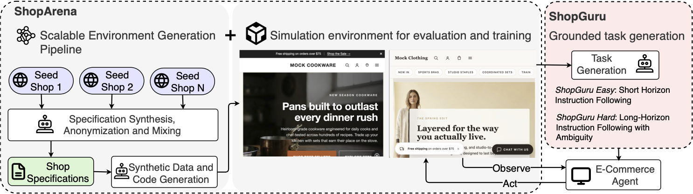

# ShopGym

[](./LICENSE)


ShopGym is an integrated framework for realistic simulation and scalable benchmarking of e-commerce web agents, functions as both as a simulation environment and as a benchmark construction pipeline.



## Components

The repository is a pnpm mono-repo of TypeScript packages:

| Package | Role |
|---|---|
| [`packages/core`](packages/core) | **Core** - shared task / result schemas (zod), the file-based pipeline runner, and the `.env` credentials loader. |
| [`packages/agent`](packages/agent) | **Agent** - the `AgentRuntime` / `LlmClient` / `Tool` / `Trajectory` seam, the pi SDK adapter, and `FakeRuntime` plus the conformance suite. |
| [`packages/harness`](packages/harness) | **Harness** - runtime-agnostic plan-then-loop engine: workspace, seed immutability, verifier dispatch, resume, telemetry. |
| [`packages/browser`](packages/browser) | **Browser** - per-episode Playwright `BrowserSession`, agent `browserTools` on aria-snapshot refs, and `probe` for graders. |
| [`packages/shop_backend`](packages/shop_backend) | **ShopBackend** - Storefront-API-compatible GraphQL server with episode-scoped state (carts, customers, checkout, orders); also the backend template seeded into every generated shop. |
| [`packages/shop-arena`](packages/shop-arena) | **ShopArena** - storefront exploration (`explore`), SandboxShop generation (`gen`), and the storefront template under `templates/storefront`. |
| [`packages/shop-guru`](packages/shop-guru) | **ShopGuru** - benchmark pipeline: seed and explored tasks, `AgentUnderTest` episodes, graders, `aggregate.json`. |
| [`packages/cli`](packages/cli) | **CLI** - the `shopgym` binary: `explore`, `gen`, `host`, `guru`, `trace`, `doctor`. |

A typical loop:

```
shopgym explore  ->  Shop Manual  ->  shopgym gen  ->  SandboxShop (data + storefront + backend)
                                                              |
                                                       shopgym host
                                                              |
                                                       shopgym guru  ->  benchmark + evaluation
```

## Requirements

- Node >= 22.19 (required by the `pi` SDK) with [`pnpm`](https://pnpm.io/) >= 9 (the repo pins
  `pnpm@9.12.0` via `packageManager`).
- Playwright's Chromium, used by exploration, the build-loop verifiers, and
  benchmark episodes.
- A `.env` at the repo root with model credentials. Either a gateway key
  (`PI_PROXY_API_KEY`) together with `ANTHROPIC_BASE_URL` / `OPENAI_BASE_URL`
  routing, or provider keys (`ANTHROPIC_API_KEY` or `ANTHROPIC_AUTH_TOKEN`,
  `OPENAI_API_KEY`). Shell exports take precedence over `.env`; credentials
  are read once per command and never written to disk.

## Setup

```bash
pnpm install
pnpm -r build
pnpm --filter @shop-gym/browser exec playwright install chromium   # once per machine

cp .env.example .env    # then fill in the keys you use
node packages/cli/dist/main.js doctor
```

`doctor` checks Node, pnpm, Chromium, both templates, and which credential
key names are present in `.env` / the environment (values are never
printed). It exits 1 with a remedy per failing check.

`pnpm install` also installs the `pi-playwright` browser skill into
`node_modules/`; the repo's `.claude/skills/playwright-browser` symlink
exposes that same skill tree to Claude Code.

## Quick start

Every command below is a `shopgym` subcommand; from the repo root run it as
`node packages/cli/dist/main.js <cmd>` (built by `pnpm -r build`). Progress goes to stderr,
the result (a path, URL, or number) to stdout. The default model is
`openai/gpt-5.5`; pass `--model <provider>/<id>` to override. See
[`packages/cli/README.md`](packages/cli/README.md) for every flag.

### 1. Explore a storefront

```bash
shopgym explore https://example-shop.com
# -> outputs/shop_manuals/<host>/<run_id>/manual.md
#    (+ capabilities.json, stats.json, seed/prefetch/, run/)
```

Options: `--out <dir>`, `--max-iters <n>`, `--timeout <ms>`,
`--from prefetch|explore|merge|synthesize`, `--force-resume`. Re-running with
the same output directory resumes the unfinished step.

### 2. Generate a SandboxShop

```bash
shopgym gen outputs/shop_manuals/<host>/<run_id> --name mock_shop
# -> outputs/shops/mock_shop/
```

`gen` accepts several manual directories (they are merged), `--gen-backend`
to let the build agent extend the shop's backend copy, `--image-backend
placeholder|openai` (`openai` needs `OPENAI_API_KEY`), catalog sizing
(`--collections`, `--products-per-collection`, `--images-per-product`),
`--build-model <ref>` for the build loop, and `--from manual_merge|data_synth|
data_validation|build|final_eval|publish` to force a step and everything after
it. Output layout:

```
outputs/shops/mock_shop/
  manual/        merged shop manual (manual.md, capabilities.json, parts/)
  data/          SandboxShop dataset (store, products, collections, ..., images/)
  runs/build/    harness run of the build loop (plan.md, iters/, artifact/)
  final_eval/    visual + functional sweep report (advisory)
  storefront/    published storefront source
  backend/       published backend source (serves data/)
  shop.json      publish manifest (templates, genBackend, finalStatus)
```

### 3. Host the shop

```bash
shopgym host start mock_shop 4000     # or `pnpm shop:host start mock_shop 4000`
# -> mock_shop storefront=http://127.0.0.1:4000 backend=http://127.0.0.1:<port>
```

See [Hosting a generated shop](#hosting-a-generated-shop) for `stop`,
`restart`, `list`, and where logs live.

### 4. Build a benchmark for the shop

Write a config (copy
[`packages/shop-guru/configs/default.json`](packages/shop-guru/configs/default.json);
relative paths resolve against the config file) pointing at the URLs printed
in step 3 and the shop's `data/` directory:

```json
{
  "shop": "mock_shop",
  "shopUrl": "http://127.0.0.1:4000",
  "backendUrl": "http://127.0.0.1:<backend port>",
  "dataDir": "../../../outputs/shops/mock_shop/data",
  "outDir": "../../../outputs/shop_guru",
  "model": { "provider": "openai", "id": "gpt-5.5" },
  "caps": { "exact": 5, "browse": 5, "account": 3, "checkout": 3 }
}
```

```bash
shopgym guru build --config configs/mock_shop.json
# -> outputs/shop_guru/mock_shop/benchmarks/<skill>.json
shopgym guru explore --config configs/mock_shop.json   # optional: agent-discovered tasks
```

### 5. Evaluate an agent against the shop

The shop from step 3 must be running.

```bash
shopgym guru eval --config configs/mock_shop.json [--skills exact,browse] [--concurrency 4]
# -> outputs/shop_guru/mock_shop/runs/<run_id>/{results.json,aggregate.json,episodes/<task_id>/}
#    stdout: the run directory, then the pass rate
```

`solve` runs the episodes without grading; `--model` and `--judge-model`
override the agent and judge models. See
[`packages/shop-guru/README.md`](packages/shop-guru/README.md) for the config
fields, the `AgentUnderTest` interface, and the output layout.

## Common commands

```bash
pnpm install                     # install the workspace
pnpm -r build                    # build every package (produces packages/cli/dist/main.js)
pnpm -r typecheck                # tsc --noEmit for every package
pnpm -r test                     # vitest for every package
pnpm lint                        # biome check
pnpm format                      # biome format
pnpm codegen:check               # shop_backend GraphQL codegen drift check

SHOPGYM_SLOW_TESTS=1 pnpm -r test   # also install/build the templates and host a fixture shop
SHOPGYM_LIVE=1 pnpm -r test         # also call real models (reads .env); SHOPGYM_LIVE_MODEL=<provider>/<id>

pnpm --filter @shop-gym/shop-backend dev   # run the GraphQL server against a dataset
node packages/cli/dist/main.js trace <iter_dir>   # render a harness iteration as text
```

## Hosting a generated shop

`shopgym host` (alias `pnpm shop:host`, see
[`packages/cli/README.md`](packages/cli/README.md)) brings up a published shop
end-to-end: the shop's own `backend/` serving `outputs/shops/<name>/data/`
plus its `storefront/` wired to it. Both processes run detached; pid, port and
log bookkeeping lives under `.run/shops/<name>/`.

`<shop>` is a name under `outputs/shops/` or a path to a published shop
directory (one containing `shop.json`). The storefront runs on `[port]` (a free
port when omitted) and the backend on another free port. `start` refuses a
port that is already bound and a shop whose `shop.json` does not record
`finalStatus: completed` (pass `--force` to host it anyway). The first start
runs `pnpm install --ignore-workspace` and `pnpm build` in `storefront/` and
`backend/`; later starts reuse that output until the shop is republished.

```bash
pnpm shop:host start mock_shop             # auto-pick a free port
pnpm shop:host start mock_shop 8000        # or pick the storefront port
# -> mock_shop storefront=http://127.0.0.1:8000 backend=http://127.0.0.1:<port>

pnpm shop:host list                        # running shops: status, URLs, pids
pnpm shop:host list -a                     # plus every published shop under outputs/shops/
pnpm shop:host stop mock_shop              # or `stop all`
pnpm shop:host restart mock_shop           # same storefront port
```

Server output goes to `.run/shops/<name>/{backend,storefront}.log`; install and
build output to `.run/shops/<name>/build.log`.

## Repository layout

```
shop-gym/
├── AGENTS.md                   # agent behavior + coding guidelines
├── CLAUDE.md -> AGENTS.md
├── README.md
├── docs/
│   └── specs/                  # design specifications (intent, not reality)
├── packages/
│   ├── core/                   # @shop-gym/core: schemas, pipeline runner, credentials
│   ├── agent/                  # @shop-gym/agent: AgentRuntime seam + pi adapter
│   ├── harness/                # @shop-gym/harness: plan-then-loop engine
│   ├── browser/                # @shop-gym/browser: Playwright session + browser tools
│   ├── shop_backend/           # @shop-gym/shop-backend: GraphQL server + backend template
│   ├── shop-arena/             # @shop-gym/shop-arena: explore, gen, templates/storefront
│   ├── shop-guru/              # @shop-gym/shop-guru: benchmark build / explore / solve / eval
│   └── cli/                    # @shop-gym/cli: the `shopgym` binary
├── outputs/                    # generated artifacts (gitignored): shop_manuals, shops, shop_guru
├── scripts/                    # thin shell helpers
├── pnpm-workspace.yaml         # pnpm workspace root
├── package.json                # root scripts (build, test, lint, codegen:check, shop:host)
├── tsconfig.base.json
├── biome.json
└── .editorconfig
```

## Citation

This repository contains code for the ShopGym paper:
[*ShopGym: An Integrated Framework for Realistic Simulation and Scalable
Benchmarking of E-Commerce Web Agents*](https://arxiv.org/abs/2605.16116).

```bibtex
@misc{savadikar2026shopgym,
    title         = {ShopGym: An Integrated Framework for Realistic Simulation and Scalable Benchmarking of E-Commerce Web Agents},
    author        = {Chinmay Savadikar and Mingyu Zhao and Yuanzheng Zhu and Han Li and Shuang Xie and Alberto Castelo and Tianfu Wu and Lingyun Wang},
    year          = {2026},
    eprint        = {2605.16116},
    archivePrefix = {arXiv},
    primaryClass  = {cs.AI},
    url           = {https://arxiv.org/abs/2605.16116}
}
```

## Contributing

See [CONTRIBUTING.md](CONTRIBUTING.md) for setup, coding standards, tests, and
pull request expectations. External contributions must pass the Shopify CLA
check, and all project spaces follow [CODE_OF_CONDUCT.md](CODE_OF_CONDUCT.md).

## License

MIT
