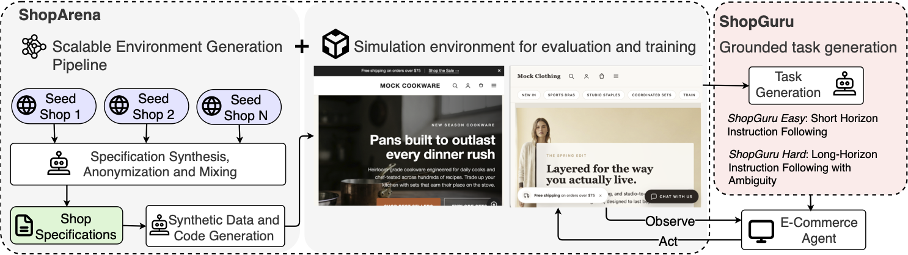

# ShopGym

[](./LICENSE)


ShopGym is an integrated framework for realistic simulation and scalable benchmarking of e-commerce web agents, functions as both as a simulation environment and as a benchmark construction pipeline.



## Components

The repository is a pnpm mono-repo of TypeScript packages:

| Package | Role |
|---|---|
| [`packages/core`](packages/core) | **Core** - shared task / result schemas (zod), Source bundle schemas and validator, the file-based pipeline runner, and the `.env` credentials loader. |
| [`packages/agent`](packages/agent) | **Agent** - the `AgentRuntime` / `LlmClient` / `Tool` / `Trajectory` seam, the pi SDK adapter, and `FakeRuntime` plus the conformance suite. |
| [`packages/harness`](packages/harness) | **Harness** - runtime-agnostic plan-then-loop engine: workspace, seed immutability, verifier dispatch, resume, telemetry. |
| [`packages/browser`](packages/browser) | **Browser** - per-episode Playwright `BrowserSession`, agent `browserTools` on aria-snapshot refs, and `probe` for graders. |
| [`packages/shop_backend`](packages/shop_backend) | **ShopBackend** - Storefront-API-compatible GraphQL server with episode-scoped state (carts, customers, checkout, orders); also the backend template seeded into every generated shop. |
| [`packages/shop-arena`](packages/shop-arena) | **ShopArena** - storefront exploration (`explore`), Source bundles from datasets (`bundle`), SandboxShop generation (`gen`), and the storefront template under `templates/storefront`. |
| [`packages/shop-guru`](packages/shop-guru) | **ShopGuru** - benchmark pipeline: seed and explored tasks, `AgentUnderTest` episodes, graders, `aggregate.json`. |
| [`packages/reports`](packages/reports) | **Reports** - local website for the HTML reports we review with teammates: an index, one shared style, and a small server. |
| [`packages/cli`](packages/cli) | **CLI** - the `shopgym` binary: `explore`, `bundle`, `gen`, `host`, `guru`, `trace`, `report`, `doctor`. |

A typical loop:

```
shopgym explore  ->  Shop Manual  ->  shopgym gen  ->  SandboxShop (data + storefront + backend)
                                                              |
                                                       shopgym host
                                                              |
                                                       shopgym guru  ->  benchmark + evaluation
```

## Requirements

- Node >= 22.19 (required by the `pi` SDK) with [`pnpm`](https://pnpm.io/) >= 9 (the repo pins
  `pnpm@9.12.0` via `packageManager`).
- Playwright's Chromium, used by exploration, the build-loop verifiers,
  benchmark episodes, and the storefront template browser suite in `pnpm test`.
- A `.env` at the repo root with model credentials. Either a gateway key
  (`PI_PROXY_API_KEY`) together with `ANTHROPIC_BASE_URL` / `OPENAI_BASE_URL`
  routing, or provider keys (`ANTHROPIC_API_KEY` or `ANTHROPIC_AUTH_TOKEN`,
  `OPENAI_API_KEY`). Shell exports take precedence over `.env`; credentials
  are read once per command and never written to disk.

## Setup

```bash
pnpm install
pnpm -r build
pnpm --filter @shop-gym/browser exec playwright install chromium   # once per machine

cp .env.example .env    # then fill in the keys you use
node packages/cli/dist/main.js doctor
```

`doctor` checks Node, pnpm, Chromium, both templates, and which credential
key names are present in `.env` / the environment (values are never
printed). It exits 1 with a remedy per failing check.

`pnpm install` also installs the `pi-playwright` browser skill into
`node_modules/`; the repo's `.claude/skills/playwright-browser` symlink
exposes that same skill tree to Claude Code.

## Quick start

Every command below is a `shopgym` subcommand; from the repo root run it as
`node packages/cli/dist/main.js <cmd>` (built by `pnpm -r build`). Progress goes to stderr,
the result (a path, URL, or number) to stdout. The default model is
`openai/gpt-5.5`; pass `--model <provider>/<id>` to override. The build agent
of `shopgym gen` runs on `openai/gpt-6-sol` unless `--build-model` is set. See
[`packages/cli/README.md`](packages/cli/README.md) for every flag.

### 1. Explore a storefront

```bash
shopgym explore https://example-shop.com
# -> outputs/shop_manuals/<host>/<run_id>/manual.md
#    (+ capabilities.json, site_graph.json, stats.json, seed/prefetch/, run/)
```

Options: `--out <dir>`, `--max-iters <n>`, `--timeout <ms>`,
`--from prefetch|explore|merge|synthesize|graph`, `--force-resume`, `--focus <text>`.
Re-running with the same output directory resumes the unfinished step.

After merge, the `graph` step writes `site_graph.json`, the Site state
graph. The graph has the page and overlay states of the storefront and
the transitions between them: the shopper actions, and the changes that
the site makes when a page loads. The step makes one LLM call
on the run's model, and one repair call when the reply fails a check.
The call gets the merged Capabilities, each finished part with no
Styling lines, and the browser actions of each executor Iteration under
its Plan task. An action shows the element name and the URL path, with
no ref, host, query value or typed text. The reply must be one JSON
object that passes `parseSiteGraph` in `@shop-gym/core`. The `source` of
each transition must name a finished Plan task. The repair call gets the
reply and its problems. If the repair reply also fails a check, the step
fails and writes no file. `--from graph` adds a graph to an existing
manual with no site traffic. A manifest from before the graph step does
not name `site_graph.json`; `--from merge` writes the manifest again and
then the graph.

Brand tokens come from the brand segment of the homepage title (the
segment that matches a hostname label, such as "Fixture Mart" in
"Fixture Mart. Spend less. Shop more.") and from `og:site_name`, so the
words of a tagline do not become brand tokens. When no segment matches,
every segment counts, but a segment that is only a stop word, such as
"Home", gives no token. Add sub-brands that the title does not name with
a repeatable `--brand-term <word>`, for example
`--brand-term Zephyr --brand-term "Nova Pass"`. A term of more than one
word matches as a phrase. The run keeps the terms in `brand_terms.json`
in the run directory; no published file holds them, and a rerun without
`--brand-term` uses them again. The Anonymization verifier uses the
terms. After synthesis, a final scan of `manual.md`, `capabilities.json`
and `stats.json` fails the run on a brand token, a brand term or the
storefront host, and `manual.md` is not written. The `graph` step runs
the same scan on `site_graph.json` before it writes the file. A leak
gets no repair call.

The storefront does not have to be a Shopify shop. Prefetch decides the
platform first. It fetches `robots.txt`, the homepage, `sitemap.xml` and
one `/products.json` page as the probe: the platform is `shopify` when the
homepage has a Shopify marker or the probe returns a product list, else
`generic`. On a Shopify shop it then fetches the rest of the catalog, the
Shopify JSON endpoints and the policy pages. On a generic site it fetches
nothing more, and the planner picks its start URLs from the homepage links
and the sitemap. `manifest.json` records the `platform`.

`stats.json` records its `source` and its `sample_size`. On a Shopify shop
the source is `catalog_endpoint`: the stats come from the catalog that
prefetch read. On a generic site the source is `observed_sample`: the
executors record one product observation (price, currency, variant facts)
for each product page that they open, with a tool that takes a key of the
page from the browser. The price and variant stats come from these
observations, and each product page counts once. The product and
collection totals stay 0.

On a large site, `--focus "<text>"` keeps the run in one part of the site,
for example `--focus "Video Games"`. The planner gets the focus as a hint: it
picks start URLs, product pages and search queries in that part, and it still
plans the site-wide areas (header, footer, cart, checkout entry). It writes
the focus into the task briefs, so the executors get it too. Navigation
outside the focus is not blocked. `manifest.json` records the `focus`, or
`null` when the run has none. A resumed run keeps its plan, so a re-run on the
same output directory must pass the same `--focus`.

Exploration never tries to pass a bot check. Prefetch stops on a captcha,
interstitial or rate-limit homepage with the reason `bot_check`, and on a
Cloudflare challenge homepage with the reason `cloudflare_challenge`. In a
run, the Browser tools refuse `click`, `type`, `select` and `press` on a
bot-check page, a Plan task that meets a bot check is marked blocked with
the note "bot check", and the run goes on. Two
Iterations in a row with a bot check, or the navigation cap of 200
`navigate` calls per run, stop the run. A stopped run still writes the
manual from the finished parts, lists the unfinished areas as
`coverage_gaps`, records the stop in `manifest.json`, and exits 0.

### 2. Generate a SandboxShop

```bash
shopgym gen outputs/shop_manuals/<host>/<run_id> --name mock_shop
# -> outputs/shops/mock_shop/
```

`gen` accepts several manual directories (they are merged), `--gen-backend`
to let the build agent extend the shop's backend copy, `--image-backend
placeholder|openai` (`openai` needs `OPENAI_API_KEY`), catalog sizing
(`--collections`, `--products-per-collection`, `--images-per-product`),
`--build-model <ref>` for the build loop (default `openai/gpt-6-sol`, even
if `--model` is set), and `--from manual_merge|data_synth|
data_validation|build|final_eval|publish` to force a step and everything after
it. `--data <dataset dir>` copies the catalog of an existing SandboxShop
Dataset, for example `outputs/shops/<old shop>/data`. It keeps the products,
the collections and the images without change. It drops the collections that
have no products. All other data comes from the manual
([ADR 0017](docs/adr/0017-gen-may-copy-a-sandboxshop-catalog.md)). The catalog
sizing and `--image-backend` do not apply with `--data`. Output layout:

```
outputs/shops/mock_shop/
  manual/        merged shop manual (manual.md, capabilities.json, parts/ with standard.md)
  data/          SandboxShop dataset (store, products, collections, ..., images/)
  runs/build/    harness run of the build loop (plan.md, iters/, artifact/)
  final_eval/    visual + functional sweep report (advisory)
  storefront/    published storefront source
  backend/       published backend source (serves data/)
  shop.json      Shop manifest (sourceManuals, templates, genBackend, finalStatus)
```

Every SandboxShop has customer accounts: register, log in and out, "Forgot
your password?", order history and order detail, and an address book. It
also has a one-page checkout with a "Discount code" field and a thank-you
page. An announcement bar shows each Discount code with its hint, and
product Reviews have stars, sorting and paging. These pages follow the Standard
sub-manual, `manual/parts/standard.md`, which every shop gets and which
manual merge fits to the shop's observed account and checkout notes
([ADR 0016](docs/adr/0016-standard-sub-manual-for-account-and-checkout.md)).
The Storefront template already builds them. The `gen_account` and
`gen_checkout` build tasks only restyle them, and the `account_flow` and
`discount_flow` Verifiers drive their forms in a browser. Data synthesis
makes three to five Discount codes, five Personas, fifteen seeded orders
with mixed statuses, and Reviews. See the
[ShopArena](docs/specs/shop_arena/standard_account_checkout.md) and
[ShopBackend](docs/specs/shop_backend/account_discount_reviews.md) specs.

The build agent runs shell commands on your machine, without a sandbox
([ADR 0015](docs/adr/0015-build-loop-runs-on-the-host.md)). It can read
every file you can, but its commands get no API keys or tokens from your
environment, and nothing they start outlives the call. Run `gen` only on
manuals you trust.

### 3. Host the shop

```bash
shopgym host start mock_shop 4000     # or `pnpm shop:host start mock_shop 4000`
# -> mock_shop storefront=http://127.0.0.1:4000 backend=http://127.0.0.1:<port>
```

See [Hosting a generated shop](#hosting-a-generated-shop) for `stop`,
`restart`, `list`, and where logs live.

### 4. Build a benchmark for the shop

Write a config (copy
[`packages/shop-guru/configs/default.json`](packages/shop-guru/configs/default.json);
relative paths resolve against the config file) pointing at the URLs printed
in step 3 and the shop's `data/` directory:

```json
{
  "shop": "mock_shop",
  "shopUrl": "http://127.0.0.1:4000",
  "backendUrl": "http://127.0.0.1:<backend port>",
  "dataDir": "../../../outputs/shops/mock_shop/data",
  "outDir": "../../../outputs/shop_guru",
  "model": { "provider": "openai", "id": "gpt-5.5" },
  "caps": { "exact": 5, "browse": 5, "account": 3, "checkout": 3 }
}
```

```bash
shopgym guru build --config configs/mock_shop.json
# -> outputs/shop_guru/mock_shop/benchmarks/<skill>.json
shopgym guru explore --config configs/mock_shop.json   # optional: agent-discovered tasks
```

### 5. Evaluate an agent against the shop

The shop from step 3 must be running.

```bash
shopgym guru eval --config configs/mock_shop.json [--skills exact,browse] [--concurrency 4]
# -> outputs/shop_guru/mock_shop/runs/<run_id>/{results.json,aggregate.json,episodes/<task_id>/}
#    stdout: the run directory, then the pass rate
```

`solve` runs the episodes without grading; `--model` and `--judge-model`
override the agent and judge models. See
[`packages/shop-guru/README.md`](packages/shop-guru/README.md) for the config
fields, the `AgentUnderTest` interface, and the output layout.

See the [shopping task generation proposal](docs/specs/shop_guru/task_generation_proposal.md)
for sandbox limitations, three generation methods, validation and difficulty,
and the proposed 9-shop, 900-task RL and transfer-evaluation pilot across six SandboxShops and three real shops.

## Source bundles

`shopgym bundle` turns a source dataset into a raw **Source bundle**: a
catalog, its reviews, and the User events of a few modeled users, in one
format for every dataset. The first adapter reads Amazon Reviews 2023 (a
research dataset with no license; use it for research only). Put the
category files under `outputs/` (gitignored) and run:

```bash
node packages/cli/dist/main.js bundle amazon_reviews_2023 outputs/sources/amazon_reviews_2023/raw \
  --category Video_Games --out outputs/bundles/vg_10k --cutoff 2022-07-16 \
  --products 10000 --users 200 --seed 7 --reviews-per-product 50
# -> outputs/bundles/vg_10k/{bundle.json,catalog/products.jsonl,catalog/reviews.jsonl,catalog/images/,events/events.jsonl,report.json}
```

The sampling starts from the users. It picks `--users` users at random
among those with at least `--min-events-before` (default 5) User events
before the cutoff and one purchase after it. It keeps every product in
their histories. Then it fills up to `--products` with the most reviewed
products of the same categories. Each review gives a `review` event, and a
verified review also gives an inferred `purchase` event. Only modeled users
get User events. `--reviews-per-product` keeps a seeded choice of the
reviews of each product, and always keeps the reviews of modeled users.
The same options and seed give the same bytes. On Video_Games (4.6M review
rows) a run takes about 45 s and 2.7 GB of memory, before the images.

Then the bundle downloads the first `--images-per-product` (default 1)
large images of each product into `catalog/images/`, and records the
local `path` next to the `source_url` of each image. The download
requests only the image URLs of the dataset, four at a time, with a
30 s time limit and three retries with backoff. It never tries to get
past a block: a refusal (a redirect, a 401, 403 or 429, or an answer that
is not an image) is not retried, and 10 refusals in a row stop the
download. Failed images are listed in `report.json` and do not fail the
bundle. `--from images` tries the missing images again and skips the
files already on disk. `--images-per-product 0` turns the download off. See
[`packages/shop-arena/README.md`](packages/shop-arena/README.md#bundle) for
the field map and the step layout.

## Common commands

```bash
pnpm install                     # install the workspace
pnpm -r build                    # build every package (produces packages/cli/dist/main.js)
pnpm -r typecheck                # tsc --noEmit for every package
pnpm -r test                     # vitest for every package, incl. the storefront template browser suite
pnpm lint                        # biome check
pnpm format                      # biome format
pnpm codegen:check               # shop_backend GraphQL codegen drift check

SHOPGYM_SLOW_TESTS=1 pnpm -r test   # also install/build both templates and host a fixture shop
SHOPGYM_LIVE=1 pnpm -r test         # also call real models (reads .env); SHOPGYM_LIVE_MODEL=<provider>/<id>

pnpm --filter @shop-gym/shop-backend dev   # run the GraphQL server against a dataset
node packages/cli/dist/main.js trace <iter_dir>   # render a harness iteration as text
pnpm reports                     # serve the review reports at http://127.0.0.1:4100
```

## Review reports

Markdown in `docs/` is the record: plans, specs, ADRs, proposals and final
designs. For a review, we make an HTML report from that Markdown and commit it
to [`packages/reports/pages/`](packages/reports). `pnpm reports` serves every
report with an index and one shared style, for review with teammates. After the
review, the decisions go back into the Markdown in `docs/`. See
[`packages/reports/README.md`](packages/reports/README.md) for the report
format.

## Hosting a generated shop

`shopgym host` (alias `pnpm shop:host`, see
[`packages/cli/README.md`](packages/cli/README.md)) brings up a published shop
end-to-end: the shop's own `backend/` serving `outputs/shops/<name>/data/`
plus its `storefront/` wired to it. Both processes run detached; pid, port and
log bookkeeping lives under `.run/shops/<name>/`.

`<shop>` is a name under `outputs/shops/` or a path to a published shop
directory (one containing `shop.json`). The storefront runs on `[port]` (a free
port when omitted) and the backend on another free port. `start` refuses a
port that is already bound and a shop whose `shop.json` does not record
`finalStatus: completed` (pass `--force` to host it anyway). The first start
runs `pnpm install --ignore-workspace` and `pnpm build` in `storefront/` and
`backend/`; later starts reuse that output until the shop is republished.

```bash
pnpm shop:host start mock_shop             # auto-pick a free port
pnpm shop:host start mock_shop 8000        # or pick the storefront port
# -> mock_shop storefront=http://127.0.0.1:8000 backend=http://127.0.0.1:<port>

pnpm shop:host list                        # running shops: status, URLs, pids
pnpm shop:host list -a                     # plus every published shop under outputs/shops/
pnpm shop:host stop mock_shop              # or `stop all`
pnpm shop:host restart mock_shop           # same storefront port
```

Server output goes to `.run/shops/<name>/{backend,storefront}.log`; install and
build output to `.run/shops/<name>/build.log`.

## Repository layout

```
shop-gym/
├── AGENTS.md                   # agent behavior + coding guidelines
├── CLAUDE.md -> AGENTS.md
├── README.md
├── GLOSSARY.md                 # domain terms
├── docs/
│   ├── adr/                    # architecture decision records
│   ├── agents/                 # agent skill config (issue tracker, labels, domain docs)
│   ├── reports/                # point-in-time HTML review reports
│   └── specs/                  # design specifications (intent, not reality)
├── packages/
│   ├── core/                   # @shop-gym/core: schemas, bundle validator, pipeline runner, credentials
│   ├── agent/                  # @shop-gym/agent: AgentRuntime seam + pi adapter
│   ├── harness/                # @shop-gym/harness: plan-then-loop engine
│   ├── browser/                # @shop-gym/browser: Playwright session + browser tools
│   ├── shop_backend/           # @shop-gym/shop-backend: GraphQL server + backend template
│   ├── shop-arena/             # @shop-gym/shop-arena: explore, bundle, gen, templates/storefront
│   ├── shop-guru/              # @shop-gym/shop-guru: benchmark build / explore / solve / eval
│   ├── reports/                # @shop-gym/reports: review reports site (pages/, assets/, server)
│   └── cli/                    # @shop-gym/cli: the `shopgym` binary
├── outputs/                    # generated artifacts (gitignored): shop_manuals, bundles, shops, shop_guru
├── scripts/                    # thin shell helpers
├── pnpm-workspace.yaml         # pnpm workspace root
├── package.json                # root scripts (build, test, lint, codegen:check, shop:host, reports)
├── tsconfig.base.json
├── biome.json
└── .editorconfig
```

## Citation

This repository contains code for the ShopGym paper:
[*ShopGym: An Integrated Framework for Realistic Simulation and Scalable
Benchmarking of E-Commerce Web Agents*](https://arxiv.org/abs/2605.16116).

```bibtex
@misc{savadikar2026shopgym,
    title         = {ShopGym: An Integrated Framework for Realistic Simulation and Scalable Benchmarking of E-Commerce Web Agents},
    author        = {Chinmay Savadikar and Mingyu Zhao and Yuanzheng Zhu and Han Li and Shuang Xie and Alberto Castelo and Tianfu Wu and Lingyun Wang},
    year          = {2026},
    eprint        = {2605.16116},
    archivePrefix = {arXiv},
    primaryClass  = {cs.AI},
    url           = {https://arxiv.org/abs/2605.16116}
}
```

## Contributing

See [CONTRIBUTING.md](CONTRIBUTING.md) for setup, coding standards, tests, and
pull request expectations. External contributions must pass the Shopify CLA
check, and all project spaces follow [CODE_OF_CONDUCT.md](CODE_OF_CONDUCT.md).

## License

MIT
