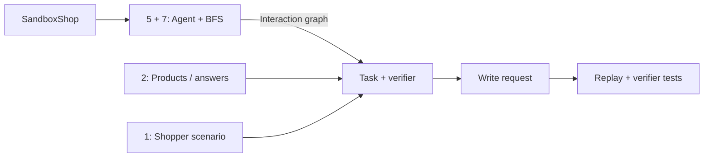

# Shopping Task Generation Proposal

Status: **Proposed** · Audience: **ShopGym developers**

## Overview

ShopGuru’s ten seed skills mostly fill fixed templates: named-product search,
policy-page navigation, and simple shopping cart edits. They provide little
coverage of product selection, policy reasoning, or purchase planning. [C1]

We propose **23 task families + six scenario variations**, generated by combining
**parameterized scenarios, product/answer data, and agent-guided BFS**. The main
sections describe the design; the [full catalog](#h-detailed-task-catalog)
contains per-family examples, support gaps, generation recipes, and verifiers.

## Terminology

- **Task family:** a type of shopper goal, grouped by shopping stage.
- **Scenario variation:** an added condition, such as clarification or recovery.
- **Validated solution:** a feasible completion; other valid outcomes remain acceptable.

## Current Status

Shared implementation support is summarized below. Each generated shop still
needs data and UI validation. See the [capability audit](#a-baseline-capability-audit).

| Area | Existing implementation | Missing work |
| --- | --- | --- |
| Commerce | Isolated shopping carts, customer/address reads, order history, simulated checkout, inventory changes. [C4] [C5] [C6] | Profile edits, wishlists, reviews, after-sales, coupon pricing, richer logistics. |
| Account access | Backend/template registration, login, logout; seed reads a pre-authenticated profile. [C9] [C14] [C15] | Dedicated account-action tasks and verifiers. |
| Exploration | Browser-driven task proposals; reachability and locator checks. [C11] [C17] | Persistent interaction graph and full-workflow replay. |
| Evaluation | Text, URL, locator, snapshot, and LLM checks. [C3] | Constraint queries, optimization, state diffs, trusted events, shopper dialogue. |

## Desired Status

Generate realistic tasks across shopping stages and difficulty levels. Each task
needs accessible evidence, reproducible setup, a solution or infeasibility proof,
and a verifier tested against valid alternatives and likely mistakes.

## Proposal

### Generation design: 1 + 2 + (5 + 7)

Combine **1. parameterized scenarios**, **2. product/answer-first construction**,
and **5 + 7. functionality discovery with graph search**.
[Appendix B](#b-existing-work-and-task-generation-approaches) compares all eight methods.

Scenarios define goals and permitted changes; grounded data supplies constraints
and valid outcomes. Fix setup and success criteria before an LLM writes the
request. Reference answers and replay paths remain in the validation record.

### Interaction graph

- **Explore generated SandboxShops.** The agent identifies controls and meaningful inputs; BFS schedules states and deduplicates visits.
- **Node = page type + key interaction state**, such as empty/populated shopping cart or signed-in/out account. Entity IDs remain parameters; split nodes when controls or behavior differ.
- **Record controls and transitions:** name, type, required inputs, enabled state, action, and resulting UI/backend changes. Distinguish observed controls from tested actions.
- **Reset and replay branches.** A graph path is a workflow candidate; validate its concrete bindings through independent task replay. Exploration budgets limit coverage.

[Appendix G](#g-interaction-graph-and-exploration-details) covers graph records,
state abstraction, and replay mechanics.

**Example:** “Replace the large coffee pack with two small packs; keep everything else.”

| Source | Used for this task |
| --- | --- |
| Graph | Quantity and removal controls. |
| Catalog | Pack variants, prices, and stock. |
| Scenario | Initial shopping cart and items to preserve. |
| Verifier | Final variant IDs, quantities, and unchanged lines. |

### Task coverage

| Category | Families | Goals covered | Main additions needed |
| --- | --- | --- | --- |
| Discovery and decision | 01–08 | Find, recommend, compare, substitute; assess fit, reviews, and policies. | Grounded constraints, suitability rubrics, review data. |
| Shopping cart and purchase | 09–14 | Select variants, revise a shopping cart, plan purchases, optimize totals, check out. | Planning checks, promotion rules, delivery/pickup models. |
| Accounts and repeat shopping | 15–19 | Access accounts, manage preferences, save products, inspect orders, reorder. | Account-action tasks; profile and wishlist mutations. |
| After-sales | 20–23 | Modify/cancel orders, return/exchange, manage reviews and subscriptions. | Commerce records, lifecycle rules, mutations, and UI. |
| Scenario variations | V1–V6 | Memory, clarification, changing requirements, recovery, action boundaries, cross-shop shopping. | Dialogue, controlled events, memory, coordinated episodes. |

The [full catalog](#h-detailed-task-catalog) specifies examples and verification
for each family. ShopGym v2 development will add the missing commerce and runner
capabilities.

### Difficulty

Reuse [VisualWebArena’s action bands](https://arxiv.org/html/2401.13649#S4.SS2):

| Easy | Medium | Hard |
| --- | --- | --- |
| ≤3 browser actions | 4–9 browser actions | ≥10 browser actions |

Assign each instance from an efficient, human-reviewed replay with fixed setup.
Count individual operations; exclude observations, setup, and agent retries.
Graph distance does not determine difficulty. Catalog ranges are generation targets.

Keep [WorkArena++ ability tags](https://arxiv.org/html/2407.05291#S3.SS2)
separate: planning, information retrieval, data-driven reasoning, memory,
contextual understanding.
[Appendix F](#f-difficulty-definitions-and-annotation) specifies counting rules.

### Verification and benchmark inclusion

| Requirement | Verification |
| --- | --- |
| Structured facts and commerce outcomes | Database queries, calculations, initial/final state comparisons. |
| Suitability and explanations | Evidence-grounded LLM judge; hard constraints checked separately; human calibration. |
| Confirmation, disclosure, forbidden actions | Trusted event history; final snapshots alone are insufficient. |

Include a task after feasibility checks, fresh-episode replay, and verifier tests
against valid alternatives and targeted errors. For infeasible requests, retain
a proof and review an evidence-gathering run. See [verifier details](#c-verifier-design-notes).

Report coverage and results by **family, action tier, and variation**. Separate
environment failures from agent failures; do not add artificial Hard variants
to simple operations.

## Alternative

| Option | Main trade-off |
| --- | --- |
| Expand seed templates only | Lowest effort; limited coverage of decisions and interaction. |
| LLM-only generation and judging | Broad language coverage; harder to establish feasibility and state correctness. |
| Define a formal FSM first | Explicit transitions; requires a maintained model for each generated implementation. |

## Execution Table

| Phase | Deliverable | Ready when |
| --- | --- | --- |
| 0. Graph | Typical pages, key states, annotated controls. | Recorded transitions replay; exploration limits are reported. |
| 1. Baseline pilot | Tasks for supported discovery, shopping cart, checkout, account access, and order history. | Verifiers reject targeted errors; replay establishes difficulty. |
| 2. Richer decisions | Recommendations, compatibility, multi-item planning. | Evidence and feasibility pass audit; semantic judges are calibrated. |
| 3. Interaction | Clarification, memory, changing requirements, recovery. | Dialogue and event checks replay consistently. |
| 4. Commerce | Reviews, promotions, logistics, profile edits, after-sales. | Domain behavior, browser workflow, and verifiers pass validation. |
| 5. Expansion | Subscriptions and cross-shop tasks. | Scheduling and coordinated episodes are reproducible. |

[Appendix I](#i-detailed-rollout) maps phases to catalog IDs. Pilot allocation,
subjective-score weighting, and commerce priorities remain open.

## Appendix

### A. Baseline capability audit

The audit covers the existing implementation at
[`230c185a`](https://github.com/agentic-foundation-modeling-research/shop-gym/commit/230c185a6fd7f1616bb18cdf276d451f03c976ab),
inspected on 2026-10-22. Account support was also checked on 2026-10-23 with nine
backend tests and two storefront HTTP smoke tests. These exercise registration,
credential validation, token revocation, protected account
pages, and episode isolation against fixtures. [C14] [C16]

Environment capabilities and benchmark coverage are assessed separately.
Generated shops can expose fewer features or extend the backend, so
each shop needs its own data and browser validation before receiving tasks.

The baseline provides:

- Ten deterministic seed skills: `exact`, `substitute`, `browse`, `filter`,
  `shipping`, `returns`, `e2e`, `account`, `checkout`, and `order_history`.
  These names cover narrower behavior than some proposed families: `returns`,
  for example, locates a policy page rather than executing a return. [C1]
- Shopping carts isolated by episode, customer and address reads, order history,
  simulated order placement, inventory changes, reset, and grader snapshots.
  [C4] [C5] [C6]
- Backend registration and credential validation, access-token creation and
  revocation, and storefront routes that store or clear the session cookie.
  These routes use sandbox customer records and episode-scoped sessions.
  [C9] [C14]
- `string_match`, `url_match`, `locator_probe`, `state_check`, and explicit
  `llm_judge` checks. `state_check` supports equality, subsets, and array
  membership. All configured checks must pass. Fuzzy text matching also invokes
  a judge. [C2] [C3]
- An explorer that proposes tasks and checks page reachability and locators in a
  fresh browser. It does not replay a full solution or establish feasibility
  and semantic correctness for every check type. [C11]

The following limits affect the proposed catalog:

- The runner posts credentials to `/account/login` before handing control to the
  agent for account seeds. The seed checks the reported email and default-address
  city; it does not evaluate the agent's ability to register, log in, or log out.
  These actions need dedicated generators and checks. Profile and address editing,
  default-address changes, and saved-payment management also need mutations and
  UI. [C1] [C4] [C9] [C15]
- Checkout uses configured shipping and payment handles with simulated payment.
  Pricing supports flat tax and shipping rates and a free-shipping threshold.
  Discount codes are stored and reported as applicable, but have no eligibility
  checks or price effects. Delivery dates, geographic eligibility, and pickup
  slots are absent from commerce settings. [C5] [C7] [C8] [C10]
- The shared state and schema have no wishlist, review, subscription,
  cancellation, return, exchange, or refund workflows. A seeded financial-status
  label does not provide the records needed to calculate partial refunds. [C4] [C6] [C10]
- The task contract has one goal, optional login and shopping cart setup, and
  evaluation checks. It lacks typed difficulty, generation-method metadata,
  shopper dialogue, disclosure rules, and a memory contract across sessions. [C2] [C12]
- Built-in grading lacks arbitrary constraint queries, optimization, state diffs,
  and event-order checks. The judge receives the goal, rubric, final answer and
  URL, prior check results, and an optional final screenshot. Supplying source
  evidence and interaction history requires additional plumbing. [C3] [C12]

### B. Existing work and task generation approaches

Methods can overlap within a pipeline. **Selected** identifies components of
ShopGym's proposed generator.

| ID | Approach | Construction process | Representative work and its task generation approach | Strengths and limitations | Role in ShopGym |
| --- | --- | --- | --- | --- | --- |
| 1 | Human-authored tasks / parameterized scenarios | Define a shopper goal and scenario template; bind products, customers, and orders; prepare initial state and success conditions. | [WebArena](https://arxiv.org/html/2307.13854#S3.SS1) authors intent templates and variable instances. [AppWorld](https://arxiv.org/html/2407.18901#S3) uses scenario-specific Setup, Evaluation, and Solution programs. | Gives explicit semantics and controllable state changes; coverage depends on the scenario library and authoring effort. | **Selected:** define task families, parameterized goals, initial states, and expected outcomes. |
| 2 | Product- or answer-first generation | Sample products or an answer; extract evidence; derive satisfiable requirements; write a shopper request. | [ShoppingBench](https://arxiv.org/html/2508.04266v1) samples products, extracts fields, and simulates intent-specific queries. [EComAgentBench](https://arxiv.org/html/2606.17698v1#S4) fixes the answer and typed criteria before generating the query, profile, and clarification text. | Grounds constraints in catalog facts; needs independent checks for alternatives and realistic language rather than a restatement of product fields. | **Selected:** bind grounded product, policy, and order facts to scenarios and compute valid answers before verbalization. |
| 3 | User-purpose-first generation | Infer a shopper purpose; decompose it into activity steps; associate purchase intentions and suitable products. | [EcomScriptBench](https://arxiv.org/html/2505.15196v1#S4) mines objectives and purchase intentions from reviews, generates scripts, aligns steps with products, and adds human annotations. | Produces natural, cross-category needs; purpose, purchase necessity, and product suitability require semantic review. | Context for purpose-based scenarios in the catalog; a separate purpose-mining pipeline is not selected. |
| 4 | Feasible-solution-first generation | Construct a valid selection or plan; derive constraints, budgets, and the shopper request around it. | [ComboShoppingBench](https://arxiv.org/html/2608.09282v1#S3) validates a purchasable shopping cart before deriving a budget, coupons, and request; evaluation accepts other valid selections. [DeepPlanning](https://arxiv.org/html/2601.18137v1#S3.SS2) progressively injects constraints and adjusts candidates to retain one optimum. | Establishes at least one solution; requires explicit rules for valid alternatives, ties, and optimization. | Supporting feasibility checks for planning scenarios; a standalone solution-first generator is not selected. |
| 5 | Page-functionality-first generation | Explore pages; inspect content, controls, forms, and accessibility trees; propose tasks using observed functionality. | [Amazon-Bench](https://arxiv.org/html/2508.15832v1#S3) uses BFS exploration, page categorization, functionality-diversity sampling, LLM query generation, and human refinement. | Covers account and shopping workflows absent from catalog records; a visible control alone does not establish a working action. | **Selected, combined with 7:** annotate interactive elements and confirm their behavior during exploration. |
| 6 | Trajectory-first generation | Execute exploratory interactions; infer tasks from the resulting changes, or refine tasks and trajectories together. | [NNetNav](https://arxiv.org/html/2410.02907v1) retrospectively labels exploration trajectories. [SynWeaver](https://arxiv.org/html/2608.12429v1#S3) builds a website map with DFS, learns UI priors, and jointly refines tasks and trajectories. | Can produce demonstrations at scale; may favor actions the explorer already performs and turn requests into procedural descriptions. | Reference replay is retained for validation; retrospective labeling and website-prior training are not selected as generation components. |
| 7 | Site-graph / state-machine search | Build a page or state graph; search for evidence and reachable goals; retain paths; replay and write the task. | [GTA](https://arxiv.org/html/2605.29218v1#S2.SS1) uses BFS to cache pages and accessibility trees, then generates multi-page questions from retrieved page pairs. [AutoWebWorld](https://arxiv.org/html/2602.14296v1#S4.SS3) generates an explicit FSM and website, then uses BFS to enumerate goal-reaching action paths. | Makes reachability and composition explicit; coverage depends on exploration bounds and the state abstraction. A hyperlink graph and an executable FSM provide different guarantees. | **Selected, combined with 5:** use agent-guided BFS to build a graph of typical pages, relevant states, and observed interactions, then use it to ground task generation. |
| 8 | Joint environment, task, and verifier generation | Generate or clone an executable environment; expose internal state or an SDK; generate tasks and programmatic checks. | [VeriEnv](https://github.com/kyle8581/VeriEnv) clones frontend, backend, and database and generates tasks with SDK-based validation. [WebArena-Infinity](https://github.com/web-arena-x/webarena-infinity) generates applications and verifiable tasks with iterative testing and auditing. | Enables resettable environments and state-based checks; shared generation errors can affect the environment, task, and verifier. | ShopArena supplies the environment. Joint generation is not selected as the task-generation strategy in this proposal. |

The graph methods differ in what they assume. GTA's graph represents hyperlinks
and supporting pages. AutoWebWorld searches a formal FSM defined before the
website is generated. ShopGym will explore generated SandboxShops, grouping nodes
by page type and key interaction state while retaining concrete entity bindings
and replay evidence. Graph coverage and observed state changes must be recorded
explicitly.

For long-horizon personalization context, see
[Personalization Matters](https://arxiv.org/html/2610.11375v1).
V1–V3 require fixed disclosure rules and validated runner dialogue.

### C. Verifier design notes

Deterministic verifiers would query structured facts and compare initial and
final state. Shopping cart checks compare variant IDs and quantities as a
multiset. Order checks identify records created during the episode. Monetary
calculations use integer minor units and the shop’s declared pricing rules.
These checks establish the actual outcome: displaying a product title alone does
not establish the correct variant or quantity, and storing a coupon code does
not establish a discount.

The proposed grader extensions cover constraints, aggregation, optimization, and
state differences. Existing checks remain useful for narrower goals: URLs for
navigation, literal matching for unambiguous reported facts, and locators for
required UI evidence. Current task validation checks schemas, references, and
exact duplicate goals; it does not establish the stronger properties proposed
here. [C2] [C3] [C13]

An LLM judge would receive relevant source records or passages and a rubric that
separates the criteria being assessed. Exact constraints would have their own
checks. Before relying on subjective scores, a human-labeled sample would be
used to measure agreement and inspect false positives and false negatives.
Reporting exact and semantic components separately would make these limitations
visible in benchmark results.

Temporal requirements need trusted events for account access, confirmation,
disclosure of requirements, and forbidden actions. The runner records agent
trajectories, but a trusted event schema and corresponding grader predicates are
still proposed extensions. Snapshots establish final-state properties; events
are needed to determine what happened during the episode. [C6] [C12]

Some families need additional definitions before their verifiers can be built:

- **Promotions (12):** optimality must specify either coupon choice for a fixed
  shopping cart or product selection within a bounded candidate set.
- **Order spending (18):** the reference calculation needs a time window,
  gross or net accounting, partial-refund records, and rules for allocating tax
  and shipping.
- **Account access (15):** checks need browser session effects as well as backend
  state. Ending signed out does not establish that login and the requested read
  occurred. Password recovery and OTP are outside the baseline authentication surface.
- **Interactive variations (V1–V3):** a versioned log records active requirements
  and their disclosure. The simulator’s answers and timing need validation
  separately from the agent’s final outcome. Hidden facts must be recoverable
  through permitted observations.
- **Subscriptions and cross-shop tasks (23, V6):** recurrence and billing rules,
  product equivalence, and coordinated episode isolation need definitions before
  generation.

### D. Code evidence

These links refer to the implementation inherited from the audited baseline.
They support the current-state and support assessments in this proposal.

- [C1: Seed generators][C1] — the behavior of each existing seed family.
- [C2: Task and check schema][C2] — setup, goal, provenance, and evaluation fields.
- [C3: Grading dispatcher][C3] — check behavior and judge inputs.
- [C4: Customer schema][C4] — authentication mutations and profile and address reads.
- [C5: Checkout resolver][C5] — validation, commerce settings, and simulated placement.
- [C6: Episode snapshot][C6] — customer, session, shopping cart, order, and inventory
  state; [state transitions](../../../packages/shop_backend/src/state/shop_state.ts).
- [C7: Pricing][C7] — flat tax and shipping calculations and the free-shipping threshold.
- [C8: Shopping cart resolver][C8] — mutations and placeholder discount-code behavior.
- [C9: Account routes][C9] and [checkout route](../../../packages/shop-arena/templates/storefront/app/routes/checkout.tsx).
- [C10: Dataset schemas][C10] — catalog, customer, order, and commerce data contracts.
- [C11: Explorer verification][C11] — page and locator checks.
- [C12: Agent-under-test runner][C12] and
  [episode execution](../../../packages/shop-guru/src/solve/solve.ts).
- [C13: Task validation][C13] — schema and reference checks, goal deduplication, and caps.
- [C14: Customer resolvers][C14] — registration, credential validation, token creation,
  and revocation; [backend tests](../../../packages/shop_backend/src/resolvers/customer.test.ts).
- [C15: Task setup][C15] — login through the storefront before the agent starts.
- [C16: Storefront HTTP smoke test][C16] — registration, logout, login, protected
  account pages, and episode isolation against the shared template.
- [C17: Existing explorer][C17] — browser-driven task proposals without a persisted
  interaction graph.
- [C18: Backend client][C18] — per-episode reset and state reads.
- [C19: Browser snapshots][C19] — URL, title, and accessibility tree with temporary
  element references.

[C1]: ../../../packages/shop-guru/src/seed/index.ts
[C2]: ../../../packages/core/src/schema/task.ts
[C3]: ../../../packages/shop-guru/src/grade/grade.ts
[C4]: ../../../packages/shop_backend/src/schema/customer.ts
[C5]: ../../../packages/shop_backend/src/resolvers/checkout.ts
[C6]: ../../../packages/shop_backend/src/sandbox/snapshot.ts
[C7]: ../../../packages/shop_backend/src/state/pricing.ts
[C8]: ../../../packages/shop_backend/src/resolvers/cart.ts
[C9]: ../../../packages/shop-arena/templates/storefront/app/routes/account
[C10]: ../../../packages/shop_backend/src/data/schema.ts
[C11]: ../../../packages/shop-guru/src/explore/verify.ts
[C12]: ../../../packages/shop-guru/src/solve/agent.ts
[C13]: ../../../packages/shop-guru/src/validate.ts
[C14]: ../../../packages/shop_backend/src/resolvers/customer.ts
[C15]: ../../../packages/shop-guru/src/solve/setup.ts
[C16]: ../../../packages/shop-arena/src/templates.test.ts
[C17]: ../../../packages/shop-guru/src/explore/explore.ts
[C18]: ../../../packages/shop-guru/src/backend.ts
[C19]: ../../../packages/browser/src/snapshot.ts

### E. Research scope and prior context

Method selection builds on the
[previous ShopGym research review](https://shop-gym.quick.shopify.io/public/specs/docs/shop-gym/shopgym_v2/shopgym_v2_task_research_review.html#methods)
and the primary papers and repositories above, including 2026 work through
October. The hosted review redirected to authentication during this research;
its local counterpart was available as context, but is not part of the base
branch. Current support was assessed from code. This is a focused synthesis for
the proposed catalog; the cited benchmark results have not been replicated.

### F. Difficulty definitions and annotation

The reviewed benchmarks use several different definitions:

| Work | Definition | Use in ShopGym |
| --- | --- | --- |
| [WebArena §3.1](https://arxiv.org/html/2307.13854#S3.SS1) | Organizes tasks by information seeking, navigation, and content or configuration operations; it does not prescribe an Easy/Medium/Hard scale. | Retain the distinction between task category and difficulty. |
| [VisualWebArena §4.2](https://arxiv.org/html/2401.13649#S4.SS2) | Action difficulty uses estimated human actions: Easy ≤3, Medium 4–9, Hard ≥10. It also annotates visual difficulty. | Reuse the action bands for the three task tiers. |
| [SAGE §5.3, Table 3](https://yxw.cs.illinois.edu/files/SAGE_NeurIPS2025.pdf#page=8) | Groups WebArena tasks by human-annotated minimum steps: Easy <7, Medium 7–15, Hard >15. | An alternative step-based convention; use one published set of thresholds consistently. |
| [WorkArena++ §3.1–3.2](https://arxiv.org/html/2407.05291#S3.SS1) | L1 contains atomic tasks. L2 composes workflows with explicit instructions; L3 presents them through tickets and a knowledge base. It separately identifies the abilities being tested. | Reuse its ability categories and distinguish explicit workflows from goals requiring procedure retrieval. |

VisualWebArena provides a directly reusable three-band action definition.
WorkArena++ explains another source of difficulty: how much of the procedure the
agent must infer. We will record instruction explicitness and required abilities
alongside the action tier, preserving both short reasoning tasks and long
execution tasks in coverage reports. These ShopGym annotations do not establish
score comparability across benchmarks.

The following counting rules are proposed ShopGym conventions:

1. **Fix the setup.** Record the shop version, initial URL, authentication,
   shopping cart and other seeded state, and permitted browser operations.
2. **Replay an efficient solution.** A reviewer checks that the run succeeds
   without avoidable detours, using the same visible evidence and permitted
   actions as the agent. Count navigation, clicks, typing or filling a
   field, key presses, scrolling, and tab operations individually. Unpack batched
   tool calls; exclude fixture setup, screenshots, read-only observations,
   waiting, reasoning, and the final textual answer.
3. **Assign the tier.** Apply the published 3/9 boundaries to the reference count.
   Retain the trace and reviewer decision. It estimates efficient human effort;
   it does not claim a mathematically shortest solution. Recheck the count when
   the UI, setup, or action interface changes.
4. **Annotate additional demands.** Record abilities, instruction explicitness,
   interacting constraints, and required shopper exchanges. Dialogue turns remain
   separate from browser actions. For infeasible tasks, review an efficient
   evidence-gathering run that establishes the absence of a valid choice.
5. **Validate in the pilot.** Report success by action tier and ability tag, with
   the agent configuration and budget. Low success on a short task can reveal a
   reasoning gap without changing the task’s action tier.

### G. Interaction graph and exploration details

The graph is a proposed ShopGuru artifact for a generated SandboxShop. Existing
browser observations, episode isolation, and backend reset/state reads provide
building blocks; the graph schema, BFS controller, state abstraction, and
transition validation still need implementation. [C6] [C17] [C18] [C19]

#### Graph records

| Record | Required information | Purpose |
| --- | --- | --- |
| Page-state node | Page type, route pattern, representative URL and entity bindings, key interaction state, visible facts, screenshot/accessibility evidence, and a setup/replay recipe. | Distinguish states with different available actions while sharing structure across similar products or orders. |
| Interactive element | Role, accessible name, control type, relevant locator/context, allowed inputs, required fields, enabled/disabled state, prerequisites, and observation status. | Identify how a control can be used and distinguish discovered elements from confirmed functionality. |
| Observed transition | Source and destination node, concrete bindings, semantic action and primitive browser operations, observed prerequisites, UI result, backend state difference where relevant, and replay result. | Record how an interaction behaved for the tested case and provide an executable path segment. |
| Graph provenance and coverage | Storefront/backend/data versions, exploration setups, depth and action budgets, discovered page types/states, tested controls, failures, and unexpanded frontier. | Identify the graph's scope and determine when changed shops require re-exploration. |

The node key uses page type and key state. Useful state distinctions include a
selected variant being available or unavailable, a shopping cart being empty or
populated, a drawer being open or closed, and an account being signed in or out.
Entity IDs and concrete shopping cart lines remain in the representative
bindings and replay record. A new control signature or a different relevant
behavior requires a separate state or page subtype.

This abstraction reduces repeated exploration, but an observed transition for
one product does not prove that every product supports it. Task construction
must check the concrete bindings and replay the complete workflow. Similarly,
a path through abstract nodes is a candidate workflow until its intermediate
states and prerequisites are shown to compose.

#### Agent-guided BFS

1. **Prepare entry states.** Fix the generated shop version. Identify available
   page types and initialize representative guest and customer setups. Each
   queue entry carries the setup and action prefix needed to reproduce its
   source state.
2. **Inspect the next state.** Dequeue in BFS order, reproduce the state, and
   capture its accessibility tree and rendered evidence. The exploration agent
   classifies the page, annotates controls, and proposes meaningful action and
   input candidates. BFS owns queue order and duplicate detection.
3. **Test each branch independently.** Use a fresh browser context and reset the
   episode, reapply setup, and replay the source prefix before testing a
   candidate. Capture before/after UI and relevant backend state. Record working,
   rejected, failed, and untested interactions separately. Backend reset reseeds
   an episode; the existing API does not import arbitrary saved snapshots.
   [C18]
4. **Expand and deduplicate.** Store observed edges, including cycles. Queue a new
   page-state key when further exploration is needed. Retain concrete evidence
   for distinct control behavior and sample additional representatives where
   the abstraction may hide a capability difference.
5. **Stop with explicit bounds.** Stop when the selected frontier is exhausted
   or an exploration budget is reached. Persist the remaining frontier and
   unresolved actions. Report coverage of discovered page types, key states,
   and tested interactions without claiming complete coverage of the shop.

Element references in browser snapshots are temporary. Persist semantic control
identification and evidence, then resolve fresh references during replay. [C19]

#### Using the graph for task generation

Task metadata records family, category, variations, action count and tier,
required abilities, scenario/method IDs, capabilities, shop/graph version, source
records, and verification requirements. These fields require schema extensions. [C2]

Scenario requirements select relevant graph capabilities; graph search retrieves
or composes workflow candidates. Product- or answer-first construction supplies
concrete facts and parameters. The generator then fixes the initial state,
requirements, and independent success predicates before writing the request.
Graph paths and backend records remain generation/validation artifacts. The
evaluated agent receives the shopper request and permitted observations.

A replay failure is evidence about the candidate or graph: it may reveal an
invalid binding, a missing prerequisite, a stale transition, or an environment
bug. Correct the relevant record or defer the task. A successful replay provides
a reference solution and action count, while the verifier accepts any outcome
satisfying the request. Abstract graph distance does not determine difficulty;
the reference replay counts the primitive browser actions under the rules in
[Appendix F](#f-difficulty-definitions-and-annotation).

### H. Detailed task catalog

Each row gives two independent shopper requests. Generate an instance only when
its required facts and actions exist in the target shop. Difficulty ranges are
generation targets; concrete instances receive labels after reference replay.

**Environment support:** Basic = core operations exist; Partial = a useful subset
exists; Missing = core workflow needs implementation; Later = expansion beyond
the initial single-shop scope. These labels do not imply generator or verifier
readiness. V1–V6 can be combined with base families.

**Verification difficulty:** Low = direct checks; Moderate = joins/calculations;
High = semantic/interaction assessment. **Objectivity:** Exact = deterministic
criteria; Mixed = exact and semantic checks; Rubric-based = subjective judgment.
Task and verification difficulty are independent. A **database query** may read
catalog records, seeded records, or episode snapshots; no SQL service is required.

| ID | Category | Task family and realistic examples | Target difficulty range | Current ShopGym support and gaps | Proposed task generation approach | Required verifier(s) | Verification difficulty / objectivity |
| --- | --- | --- | --- | --- | --- | --- | --- |
| 01 | Discovery and decision | **Known-item discovery.** Find the TrailLite 20L backpack. Find its available navy variant, distinguishing it from the older model. | Easy–Medium | **Basic:** search and variant selection exist; current seeds accept any variant. [C1] | Sample an available product and similar models, then derive identifying attributes from the catalog. | Query product and variant IDs; check the answer or URL, and shopping cart contents when requested. | **Low / Exact.** |
| 02 | Discovery and decision | **Constraint-based discovery.** Find a cotton shirt under $30. Find black, machine-washable trousers in my size under $80, excluding wool. | Easy–Hard | **Partial:** filters exist; combined constraints and evidence for care instructions or materials need stronger checks. [C1] [C10] | Derive constraints from a feasible item, then enumerate all matching products and near misses. | Query attributes, price, size, and stock; check supporting text for claims outside structured fields. | **Low–Moderate / Exact; Mixed** for prose. |
| 03 | Discovery and decision | **Recommendations for a purpose or occasion.** Suggest a housewarming gift under $25. Choose a gift for a beginner gardener with a small balcony and no storage space. | Easy–Hard | **Partial:** browsing exists; generation from shopper needs and suitability rubrics are absent. [C1] | Sample a shopper need and preferences; identify suitable products using catalog evidence and an explicit rubric. | Check budget and stock with queries; use an LLM judge to assess suitability and the explanation. | **High / Rubric-based.** |
| 04 | Discovery and decision | **Comparison and value.** Which of two coffee packs is cheaper per kilogram? Compare three backpacks on capacity, weight, price, and warranty using my stated priorities. | Easy–Hard | **Partial:** prices and descriptions exist; unit conversion, warranty evidence, and comparison checks need work. [C10] | Select candidates and shopper priorities; calculate comparable values and rankings before writing the request. | Check facts, unit conversions, and rankings; use an LLM judge for qualitative trade-offs. | **Moderate / Exact or Mixed.** |
| 05 | Discovery and decision | **Substitution and unavailability.** Find a cheaper alternative to this mug. My preferred shoe is unavailable; preserve size, material, and fit within budget. | Easy–Hard | **Partial:** similarity seeds and stock data exist; substitutes need checks for the attributes the shopper wants to preserve. [C1] | Select an original item, specify which attributes can change, and enumerate available alternatives. | Query price, stock, and required attributes; exclude the original item; judge functional similarity when needed. | **Moderate–High / Mixed.** |
| 06 | Discovery and decision | **Sizing, fit, and compatibility.** Use my measurements and the size chart to choose a shirt size. Find a replacement filter for my exact appliance model and reject a similar incompatible filter. | Medium–Hard | **Partial:** descriptions and options exist; reliable size charts and compatibility data depend on the shop. [C10] | Validate size charts or model compatibility data, then sample valid choices and similar but invalid choices. | Query size ranges or compatibility relations; assess fit claims and uncertainty against the source evidence. | **Moderate / Exact; Mixed** for fit. |
| 07 | Discovery and decision | **Review-grounded research.** Summarize recurring sizing complaints for these shoes. Compare recent verified-purchase reviews, distinguishing repeated defects from isolated complaints. | Medium–Hard | **Missing:** review records, filtering, and review pages need support. [C10] | Prepare dated reviews with purchase flags and recurring or conflicting findings, then generate research questions. | Query the relevant reviews and check cited passages; use an LLM judge to assess whether the summary represents them faithfully. | **High / Mixed.** |
| 08 | Discovery and decision | **Policy and store information.** What is the return window? For a discounted gift shipped internationally, explain the applicable shipping and return conditions. | Easy–Hard | **Partial:** policy pages and navigation seeds exist; answers and policy exceptions need additional checks. [C1] | Extract rules, exceptions, and supporting passages; calculate the applicable outcome for a shopper scenario. | Evaluate policy rules and calculations; judge answers against source passages. Use URL checks for navigation-only goals. | **Low / Exact** to **High / Mixed.** |
| 09 | Shopping cart and purchase | **Variant and quantity selection.** Add two blue mugs. Add one medium black shirt and two large white shirts, using available variants only. | Easy–Hard | **Basic:** variant selection and shopping cart mutations exist; seeds need exact quantity and variant checks. [C1] [C8] | Sample available variants and quantities, then generate a request for those items. | Compare shopping cart lines by variant ID and quantity, including checks for unwanted items. | **Low / Exact.** |
| 10 | Shopping cart and purchase | **Shopping cart revision.** Remove the duplicate mug. Replace the large pack with two small packs, preserve all other lines, and keep the total under $70. | Easy–Hard | **Basic:** shopping cart setup and mutations exist; revision tasks need before-and-after checks. [C2] [C8] | Seed an initial shopping cart and define the requested changes, budget, and items that must remain unchanged. | Compare initial and final shopping carts; calculate the total and check preserved lines. | **Low–Moderate / Exact.** |
| 11 | Shopping cart and purchase | **Multi-item shopping cart planning.** Choose a notebook and pen for under $20. Build a cooking kit for four campers, covering required roles with compatible items within budget. | Medium–Hard | **Partial:** multi-item shopping carts exist; planning needs checks for required functions, compatibility, and the complete selection. [C1] | Validate one feasible shopping cart before deriving the request and budget; retain success conditions independent of that solution. | Check quantities, budget, required functions, and compatibility; judge suitability where product facts require interpretation. | **Moderate–High / Exact or Mixed.** |
| 12 | Shopping cart and purchase | **Promotions and total-cost optimization.** Apply an eligible 10% coupon. Choose the best legal coupon combination for my shopping cart, including shipping and a useful threshold top-up if it lowers the payable total. | Medium–Hard | **Partial:** tax and shipping calculations work; coupon eligibility, discounts, and stacking rules are missing. [C7] [C8] | Define promotion rules and a feasible shopping cart; compute the optimum within an explicit set of candidate choices. | Use pricing calculations, eligibility rules, and an optimizer; check that any added item serves the stated need. | **Moderate–High / Exact.** |
| 13 | Shopping cart and purchase | **Delivery, pickup, and deadlines.** Does the shop deliver to my country? Find the cheapest option arriving before Friday, with pickup as a fallback. | Easy–Hard | **Partial:** policies and flat shipping rates exist; destination eligibility, arrival dates, and pickup need support. [C5] [C10] | Generate policy questions first; after extending logistics, sample destinations, deadlines, and feasible delivery or pickup slots. | Check policy evidence, destination eligibility, dates, and the selected delivery or pickup option. | **Moderate / Exact; Mixed** for prose. |
| 14 | Shopping cart and purchase | **Checkout and order placement.** Complete guest checkout for this shopping cart using supplied details. Place the order to my office with the specified shipping and payment options and final amount. | Medium–Hard | **Basic:** simulated guest and customer checkout exist; the current seed starts signed in with a prefilled shopping cart. [C1] [C5] | Seed the shopping cart and customer details; calculate the expected total and order state after checkout. | Identify the new order; check lines, customer details, shipping and payment options, total, and inventory. Reject duplicate orders. | **Low–Moderate / Exact.** |
| 15 | Accounts and repeat shopping | **Account access.** Register with these details without marketing opt-in. Sign in, report the default-address city, then sign out. | Easy–Medium | **Basic:** backend and template routes implement registration, password login, and logout. The runner signs in for the account seed; these actions need dedicated tasks and checks. [C9] [C14] [C15] | Seed credentials or an unused email and define the expected account and session changes. | Check customer records, marketing consent, browser session state, and the required sequence of account actions. | **Low–Moderate / Exact.** |
| 16 | Accounts and repeat shopping | **Profile, addresses, and payment preferences.** Save my office address. Make it the default for future purchases, remove an obsolete address, and preserve existing orders. | Easy–Hard | **Missing for edits:** profile and address reads exist; editing, default selection, and saved-payment management need mutations and UI. [C4] [C9] | Seed customer records and define the intended edits and records that must remain unchanged. | Compare profile, address, and payment records; check the default address reference and preservation of existing orders. | **Low–Moderate / Exact.** |
| 17 | Accounts and repeat shopping | **Wishlist and saved plans.** Save these two products for later. Move available saved items below $30 into my shopping cart while retaining unavailable items in the wishlist. | Easy–Hard | **Missing:** wishlist records, persistence, mutations, and UI need support. [C6] | Seed saved items and derive the requested changes from stock and price constraints. | Compare wishlist and shopping cart contents; check quantities, retained items, and duplicates. | **Low–Moderate / Exact.** |
| 18 | Accounts and repeat shopping | **Order lookup, status, and spending.** Report my latest order status. Calculate kitchen-category spending last quarter after partial refunds. | Easy–Hard | **Partial:** order history and detail seeds exist; aggregate checks and a partial-refund ledger need adding. [C1] [C6] | Seed dated orders with product categories and calculate reference totals; include refunds once the ledger exists. | Query the customer’s orders by date and category; calculate spending using the declared refund rules. | **Low–Moderate / Exact.** |
| 19 | Accounts and repeat shopping | **Reordering.** Add the coffee from my last order to my shopping cart. Repeat the office order without pens, double the paper, and substitute an unavailable item. | Easy–Hard | **Partial:** order history, shopping carts, and checkout exist; reordering needs generation and stock-aware checks. [C6] [C8] | Start from a previous order, apply exclusions and quantity changes, then validate available substitutes. | Compare the shopping cart or new order with the source order; check quantities, exclusions, stock, and substitutions. | **Moderate / Exact or Mixed.** |
| 20 | After-sales | **Order modification and cancellation.** Cancel my unshipped order. Cancel only the duplicate order and change the other order's address if policy permits. | Easy–Hard | **Missing:** order editing and cancellation need lifecycle rules, mutations, and inventory and payment effects. [C5] [C6] | Seed orders with different eligibility states and derive permitted changes from the shop’s policy. | Check order changes, eligibility, inventory, and payment effects; verify that unrelated orders remain unchanged. | **Moderate / Exact.** |
| 21 | After-sales | **Returns, exchanges, and refunds.** Request a return for a damaged mug. Exchange a shirt's size, return one of two mugs, and explain why another line is ineligible. | Easy–Hard | **Missing:** return, exchange, and refund actions need support; policy lookup already exists. [C1] [C6] | Build scenarios from purchased items, dates, reasons, policy exceptions, and replacement stock. | Check each line’s status, amount, and inventory effects; evaluate policy rules and the explanation. | **Moderate–High / Mixed.** |
| 22 | After-sales | **Review submission and management.** Submit a four-star review using my supplied feedback. Update my own review after a replacement while preserving its purchase relationship. | Easy–Medium | **Missing:** reviews need records, authorship and purchase links, mutations, and UI. [C6] [C10] | Seed an authenticated customer, purchase, and optional existing review; generate edits from user-supplied feedback. | Check authorship, purchase links, rating, and updates; use an LLM judge to check fidelity to the supplied feedback. | **Low / Exact; High / Mixed** for text. |
| 23 | After-sales | **Subscriptions and recurring replenishment.** Set coffee delivery to every four weeks. Skip the next shipment and reduce future quantity while keeping the subscription active. | Medium–Hard | **Later:** subscription records, recurring schedules, and UI are absent. [C6] [C10] | Define subscription transitions with a controlled clock and an expected future shipment schedule. | Query subscription state and scheduled shipments; check recurrence calculations and preserved history. | **Moderate / Exact.** |
| V1 | Scenario variation | **Personalization and memory.** Use the size from my last purchase. Recommend items respecting preferences supplied across earlier sessions. | Medium–Hard | **Partial:** customer and order history exist; preference memory and control across sessions do not. [C2] [C6] | Fix shopper preferences, history, and the information available in each session before generating a personalized request. | Check history and preference constraints; judge soft preferences and verify which memory the agent could access. | **Moderate–High / Mixed.** |
| V2 | Scenario variation | **Clarification and confirmation.** Clarify which coffee I mean by “my usual.” Resolve an ambiguous delivery address and obtain the required confirmation before order placement. | Medium–Hard | **Missing:** the runner needs shopper dialogue, rules for revealing hidden requirements, and confirmation checks. [C2] [C12] | Withhold a required field from a feasible task; define the shopper’s answers and disclosure rules before the run. | Check questions, answers, and confirmation order against the disclosure log and final task state. | **High / Exact or Mixed.** |
| V3 | Scenario variation | **Incremental requirement changes.** Switch my coffee request to decaf mid-task. Tighten the budget after a proposed shopping cart and preserve the remaining requirements. | Medium–Hard | **Missing:** the runner needs controlled follow-up messages and versioned requirements. [C2] [C12] | Define a requirement change and its trigger before the run; validate a solution under the revised requirements. | Check when the change was disclosed, which requirements were active, and whether obsolete choices were removed. | **High / Exact or Mixed.** |
| V4 | Scenario variation | **Infeasibility and recovery.** Report that no available product meets all constraints without purchasing. Recover from an insufficient-stock checkout error by selecting an allowed alternative. | Medium–Hard | **Partial:** checkout can reject insufficient stock; task generation and controlled failure injection need work. [C5] | Prove that no product matches, or seed a stock shortage; specify permitted alternatives for recovery. | Check the infeasibility proof or observed error, final state, preserved records, and explanation. | **Moderate–High / Mixed.** |
| V5 | Scenario variation | **Action boundaries and collateral effects.** Research options without changing my shopping cart. Update only the specified address while preserving every unrelated address and order. | Easy–Hard | **Partial:** snapshots exist; general state comparisons and checks for transient actions do not. [C3] [C6] | Define permitted changes and forbidden actions; seed unrelated records whose state must be preserved. | Compare initial and final state; use trusted events to check forbidden actions and required confirmation order. | **Low–Moderate / Exact; High / Mixed** for traces. |
| V6 | Scenario variation | **Cross-shop shopping.** Compare the delivered price of the same product at two shops. Split a compatible shopping cart across shops while including separate shipping charges. | Medium–Hard | **Later:** coordinated setup and grading across shops are absent. [C2] [C12] | Align product identities across validated catalogs; calculate fees and a feasible allocation of purchases. | Query prices and state across shops; check equivalence and compatibility, and optimize within a bounded allocation space. | **Moderate–High / Exact or Mixed.** |

### I. Detailed rollout

Generate only tasks supported by the target shop. This table specifies the pilot
subsets and domain work behind the main rollout; implementation remains separate.

| Phase | Proposed scope | Required work | Completion criteria |
| --- | --- | --- | --- |
| 0. Interaction graph | Typical pages and supported guest/customer states | Build agent-guided BFS, page/state deduplication, control annotations, reset/replay, observed transitions, and graph versioning. | Reproduce recorded transitions; distinguish untested controls from working actions; report page, state, and action coverage within exploration bounds. |
| 1. Baseline pilot | 01–02, 08–10, 14–15, basic 18–19; supported subsets of 04–06, V4–V5 | Combine parameterized scenarios and grounded data with graph-supported workflows; add reference action counts, ability tags, and outcome checks. Add account-access tasks and verify their session changes. | Replay tasks in fresh episodes; verify difficulty annotations; accept valid alternatives; reject targeted errors; validate infeasible cases; report coverage. |
| 2. Richer decisions | 03–06, 11; complex 02, 08, 18–19 | Validate product attributes, compatibility, and policies; add solution search, calculations, and semantic rubrics. | Independently audit feasibility and evidence, and calibrate semantic checks against human judgments. |
| 3. Interactive scenarios | V1–V5 on supported base families | Add shopper dialogue, disclosure rules, controlled changes, memory fixtures, and event checks. | Replay scripted interactions, verify event order, and measure user-simulator violations. |
| 4. Commerce workflows | 07, full 12–13, 16–17, refund-aware 18, 20–22 | Add each domain’s records, rules, mutations, and UI before its generator. | Validate the domain contract, browser workflow, and verifier for each family. |
| 5. Later expansion | 23, V6 | Add subscription schedules and coordinated episodes across shops. | Review domain semantics and verify isolation, replay, and calculations across domains. |
