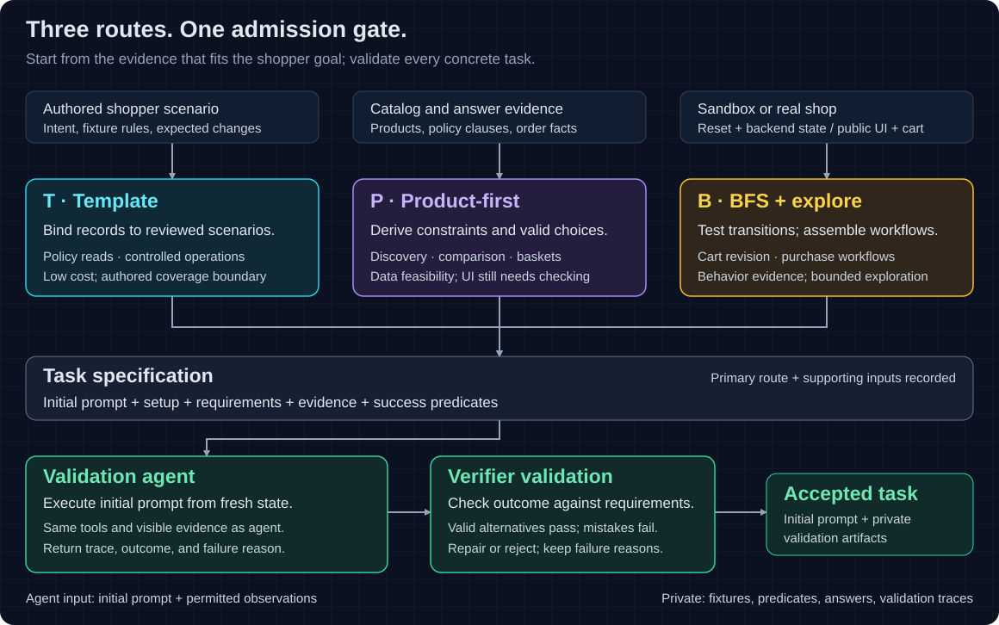
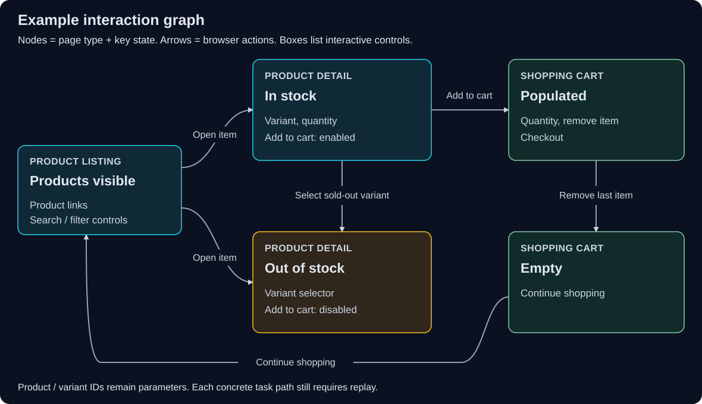

# Shopping Task Generation Proposal

Status: **Proposed** · Audience: ShopGym developers · Baseline: [v2 proposal branch, `4a6a2c5e`](https://github.com/agentic-foundation-modeling-research/shop-gym/commit/4a6a2c5e87bf1f37efc56c2ff2842bcfa197dad4), inspected 2026-10-23.

## Overview

ShopGym generates sandbox shops; ShopGuru generates tasks for agents shopping in them. The next improvement should expand **verifiable shopper goals**, rather than multiply paraphrases of existing seeds. We propose three generation methods—**template, product-first, and BFS + explore**—selected by task category and joined by shared validation. Target **100 high-quality accepted tasks per shop across six SandboxShops and three real shops (900 total)**, with **30 template / 40 product-first / 30 BFS + explore** in every shop. Train with RL only in sandboxes; evaluate on both sandbox and real shops to measure transfer. Use existing commerce features.

## Terminology

A **SandboxShop** contains a catalog, storefront, and backend. An **episode** is one agent attempt; sandbox state is isolated and resettable. A **validation agent** attempts a candidate task; a **verifier** checks its outcome. A **reference replay** repeats a verified solution without prescribing the evaluated agent's path.

## Current Status

The [ten seed skills](../../../packages/shop-guru/src/seed/index.ts) mostly bind fixed requests to products, policy pages, and simple workflows. `returns` locates a policy; it does not process returns. `account` starts already signed in. Product substitution and paraphrasing add instances without necessarily adding reasoning or workflow coverage.

The [explorer](../../../packages/shop-guru/src/explore/verify.ts) checks reachable pages and locators, not complete solutions. The [grader](../../../packages/shop-guru/src/grade/grade.ts) supports text, URL, locator, snapshot, and LLM checks, but lacks general constraint predicates, state differences, and event-order checks. A plausible task can therefore be unsolvable or incorrectly graded.

**Backend support, visible UI, and verifier readiness are separate gates.** Sandbox support below must be checked per generated shop; [Appendix A](#a-capability-evidence) links the implementation.

| Task category | Sandbox support and boundary |
| --- | --- |
| Find, filter, compare, substitute | Catalog/search/variants exist; attributes must be visible. Grounded comparison and constraint grading need work. |
| Recommend, assess compatibility, summarize reviews | Catalog evidence supports bounded factual decisions; subjective suitability needs calibration. Reviews have no shared data/workflow. |
| Policy and order questions | Policy content and order reads exist; reasoning/aggregation need explicit answer criteria. Policy text does not implement after-sales actions. |
| Cart editing and basket planning | Line/quantity mutations exist; multi-item feasibility and budget checks need generators/verifiers. |
| Checkout, discounts, delivery | Simulated checkout and stock changes exist. Coupons have no price effect; delivery dates/pickup are absent. |
| Accounts and repeat shopping | Registration/login/logout and profile/address/order reads exist. Profile edits, saved payments, and wishlists are absent; reordering needs composition. |
| After-sales, reviews, subscriptions | Cancellation, returns/exchanges/refunds, review workflows, and recurring orders need domain state, mutations, and UI. |
| Memory, clarification, recovery, cross-shop | Variations on the above; dialogue, controlled events, or coordinated episodes need runner support. |

## Desired Status

Generate tasks whose requirements are visible, feasible, and independently checkable. Measure diversity by goals, constraints, and state changes; record generation method and difficulty separately. Unsupported capabilities should produce explicit coverage gaps.

## Proposal

### Three methods, different starting points

Industry approaches differ in what grounds a task: authored intent, facts, observed functionality, or executed trajectories. The selected methods combine complementary guarantees; [Appendix B](#b-method-taxonomy) compares the wider landscape.

| Method | Mechanism and best fit | Reliability and trade-off |
| --- | --- | --- |
| **Template (T)** — [WebArena](https://arxiv.org/html/2307.13854#S3.SS1) | Author a shopper scenario, setup, and predicates; bind valid records. Best for policy lookup, account reads, and controlled cart/checkout operations. | Cheapest to audit and reproduce; coverage is bounded by authored scenarios. Bad bindings still fail. |
| **Product-first (P)** — [ShoppingBench](https://arxiv.org/html/2508.04266v1) | Choose product/answer evidence, derive satisfiable constraints and valid-outcome predicates, then write the request. Best for discovery, comparison, substitution, and basket planning. | Establishes data feasibility; does not prove UI accessibility. Risks unnatural attribute lists and treating the sampled product as the only answer. |
| **BFS + explore (B)** — [Amazon-Bench](https://arxiv.org/html/2508.15832v1#S3) | Explore working controls/states, assemble a shopper workflow, bind data, then replay. Best for cart revision and multi-page purchase/account workflows. | Finds behavior absent from catalogs; costs browser execution and favors discoverable workflows. Observed paths are not exhaustive coverage. |

All routes produce a task specification containing **`initial_prompt` + setup + requirements + evidence + success predicates**. The prompt is the shopper-facing request and must preserve the requirements. P uses backend records in sandboxes and captured public evidence on real shops. Templates supply intent even in P/B routes; record the primary method and supporting inputs. For example, P turns visible cotton/price facts into “Find a cotton shirt under $30,” accepting every match. B combines verified cart controls into “Replace the large pack with two small packs; keep the mug,” preserving unrelated lines.

For B, an agent proposes meaningful actions; **BFS controls the frontier**. Nodes are page type plus relevant state (empty/full cart, signed in/out); edges retain concrete inputs, prerequisites, UI/backend changes, and replay prefixes. In sandboxes, reset and replay before each branch. Keep self-loops that change quantities; split merged states when behavior differs. Bound exploration and retain the untested frontier. Each concrete task still needs full replay: abstract paths can conceal incompatible intermediate states.

### Validation and difficulty

Accept a candidate only after:

1. **Grounding:** independently compute valid answers or final-state constraints; confirm required facts are shopper-visible and `initial_prompt` preserves the requirements.
2. **Validation agent:** execute `initial_prompt` from the specified initial state, using the evaluated agent's tools and visible information, without private answers or reference traces. Record a successful trace for fresh replays; failure leaves feasibility unresolved.
3. **Verifier validation:** check the resulting answer/state against requirements. Valid alternatives must pass; targeted violations fail, including unchanged initial state for mutations. Check exact cart contents and newly created orders.

Use deterministic predicates for factual constraints, quantities, budgets, and state changes. Keep subjective recommendations outside V1's scored set; later use evidence-grounded, human-calibrated judges with separate scores. A verified execution demonstrates feasibility; verifier tests establish correctness only over tested cases. Measure remaining error through independent human audit.

**Real-shop validation** uses timestamped public facts and independent DOM/cart inspection; backend snapshots and exact resets are unavailable. Explore only public pages and reversible guest-cart operations. Use fresh guest sessions, verify initial state, and recheck evidence before evaluation. Changed prices, stock, or policies invalidate affected comparisons rather than count as agent failures. Checkout and account/order tasks remain sandbox-only.

Label interaction difficulty from an efficient reviewed replay: **Easy ≤3, Medium 4–9, Hard ≥10 primitive browser actions**, following [VisualWebArena](https://arxiv.org/html/2401.13649#S4.SS2). Exclude setup, observations, and retries. Also tag constraint count, cross-page evidence, and planning: a short reasoning task can be difficult despite few clicks. Never infer difficulty from BFS depth.

### First experiment

**Add zero commerce features.** First add a validation agent, capability/graph replay, constraint/state-difference grading, task provenance/difficulty metadata, and a real-shop runner/grader adapter that needs no sandbox control API. Existing operations already cover untested goals; adding coupons or returns now would confound generator quality with new environment behavior.

Use **apparel, home, and outdoors**, each with **two SandboxShops and one real shop**. Target 100 products across five collections per sandbox. Keep source-manual lineages, catalogs, and task instances separate across RL and held-out evaluation. Allocate one sandbox per domain to RL/development and one to held-out evaluation: **300 RL tasks + 300 sandbox evaluation tasks + 300 real-shop evaluation tasks**. Freeze generators before constructing held-out tasks; no real-shop data enters RL. These are pilot budgets, not power claims.

## Execution Table

T/P/B denote primary template/product-first/BFS routes. Count accepted tasks once; allocations depend on validation. Real-shop BFS covers cart edits and baskets.

| Category | Sandbox T/P/B | Sandbox total | Real T/P/B | Real total |
| --- | --- | ---: | --- | ---: |
| Find/filter | 5/15/0 | 20 | 10/10/0 | 20 |
| Compare/substitute | 0/15/0 | 15 | 0/20/0 | 20 |
| Policy questions | 10/5/0 | 15 | 15/5/0 | 20 |
| Cart edits | 5/0/15 | 20 | 5/0/20 | 25 |
| Budgeted baskets | 0/5/5 | 10 | 0/5/10 | 15 |
| Simulated checkout | 5/0/5 | 10 | — | 0 |
| Account/order reads | 5/0/5 | 10 | — | 0 |
| **Per-shop total** | **30/40/30** | **100** | **30/40/30** | **100** |
| **Dataset total** | **6 sandboxes** | **600** | **3 real shops** | **300** |

Target **30 Easy / 50 Medium / 20 Hard** per shop; report shortages instead of relaxing quality gates or padding workflows. Retain current seeds as a baseline. Compare methods within shared categories at equal generation budgets, including graph construction; measure accepted yield, distinct goals, cost per accepted task, replay stability, and verifier false accepts/rejects. Compare the same agent before/after RL with fixed evaluation budgets. Measure sandbox-to-real transfer on the five shared categories with equal category weights; report sandbox-only workflows separately. Break down success by category/difficulty and distinguish environment failures.

Proposed gates: ≥98% replay stability after freezing; audited verifier false acceptance ≤2% and false rejection ≤5%. Keep BFS if it adds ≥20% distinct validated workflow goals at ≤2× the T+P cost per accepted workflow task. [Appendix C](#c-pilot-protocol) fixes budgets, controls, and decision thresholds.

## Appendix

### A. Capability evidence

These are code-inspection findings at the baseline commit, not a runtime certification of generated shops. No benchmark results are claimed.

| Claim | Implementation evidence |
| --- | --- |
| Narrow seeds and pre-authentication | [Seed registry](../../../packages/shop-guru/src/seed/index.ts), [account seed](../../../packages/shop-guru/src/seed/account.ts), [episode setup](../../../packages/shop-guru/src/solve/setup.ts). |
| Page checks do not prove workflow feasibility | [Explorer verification](../../../packages/shop-guru/src/explore/verify.ts), [task validation](../../../packages/shop-guru/src/validate.ts). |
| Accounts support access and reads, not profile/address mutations | [Customer schema](../../../packages/shop_backend/src/schema/customer.ts), [customer resolvers](../../../packages/shop_backend/src/resolvers/customer.ts), [account routes](../../../packages/shop-arena/templates/storefront/app/routes/account). |
| Checkout is simulated; coupon applicability is a placeholder | [Checkout resolver](../../../packages/shop_backend/src/resolvers/checkout.ts), [pricing](../../../packages/shop_backend/src/state/pricing.ts), [cart resolver](../../../packages/shop_backend/src/resolvers/cart.ts). Pricing uses flat tax, shipping rates, and a free-shipping threshold. |
| Real evaluation requires a runner adapter | The [episode runner](../../../packages/shop-guru/src/solve/solve.ts) always calls [backend reset](../../../packages/shop-guru/src/backend.ts) before browser execution. Real shops need guest-browser setup and public-evidence checks instead. |
| Missing commerce domains and limited grading contract | [Dataset schema](../../../packages/shop_backend/src/data/schema.ts), [episode snapshot](../../../packages/shop_backend/src/sandbox/snapshot.ts), [task schema](../../../packages/core/src/schema/task.ts), [grader](../../../packages/shop-guru/src/grade/grade.ts). Backend snapshots expose final state; they do not establish event order. |

### B. Method taxonomy

This is a synthesis of primary-source methods, not a claim that papers use mutually exclusive categories. Sources were checked on 2026-10-23; reported benchmark results were not replicated.

| Approach | Representative mechanism | Decision for ShopGym |
| --- | --- | --- |
| Human-authored / parameterized | [WebArena](https://arxiv.org/html/2307.13854#S3.SS1): intent templates with variable bindings. | **T:** explicit semantics and inexpensive reproducibility; authoring limits coverage. |
| Product / answer-first | [ShoppingBench](https://arxiv.org/html/2508.04266v1): sample products, extract fields, generate intent-specific queries. | **P:** ground constraints before wording; accept alternative valid products. |
| User-purpose-first | [EcomScriptBench](https://arxiv.org/html/2505.15196v1#S4): infer objectives from reviews, construct scripts, associate purchase intentions/products. | Use authored needs inside T/P; defer automated purpose mining because suitability adds a separate validation problem. |
| Feasible-solution-first | [ComboShoppingBench](https://arxiv.org/html/2608.09282v1#S3): validate a basket, then derive budgets and requests. | Use within P for multi-item tasks; a feasible basket does not establish an optimum. |
| Page-functionality-first | [Amazon-Bench](https://arxiv.org/html/2508.15832v1#S3): BFS pages, categorize functionality, generate queries from controls/content. | **B:** test controls before using them as capability evidence. |
| Trajectory-first | [NNetNav](https://arxiv.org/html/2410.02907v1#S3): explore and retrospectively label trajectories. | Defer as a primary generator: explorer competence can constrain goal diversity. Keep replay for validation. |
| Graph / state-machine search | [GTA](https://arxiv.org/html/2605.29218v1#S2.SS1): hyperlink graphs and paired-page questions. [AutoWebWorld](https://arxiv.org/html/2602.14296v1#S4.SS3): BFS over a generated formal state machine, followed by GUI replay. | **B:** reuse observed page-state transitions. ShopGym has neither a complete hyperlink-only model of commerce nor a trusted complete state machine. |
| Joint environment/task/verifier generation | [VeriEnv](https://github.com/kyle8581/VeriEnv): clone frontend/backend/database, then generate tasks and executable checks using an SDK. | Keep ShopArena and task generation separate in this experiment; jointly generated code and checks can share errors. |

Keeping templates alone is the cheapest alternative. P must add constraint diversity; B must add reusable workflow coverage to justify their costs. A formal state machine would strengthen reachability guarantees but require maintaining semantics alongside every generated implementation.

### C. Pilot protocol

**Scope and preparation.** Certify three RL/development sandboxes, then three held-out sandboxes and three real shops. Select one real storefront in each domain with public product/policy evidence and guest-cart operations; final store identities require a capability audit. Do not tune methods on held-out outcomes. Keep source-manual lineages disjoint across training and evaluation, and exclude evaluation-shop captures from RL inputs. Record generation and capability failures before replacing a shop; invalidate affected results after changes. Sandbox catalog size is a target: certify enough visible attributes, variants, stock, policy clauses, and customer/order records to support the allocation. Each shop targets 100 tasks that pass all quality gates, allocated 30/40/30 to T/P/B; candidate attempts and repeated trajectories do not count toward this target. This is a small RL/transfer pilot, not a training-scale or population-representative benchmark.

V1 basket goals use explicit item roles, quantities, and merchandise-subtotal budgets, with at most three roles and six eligible candidates per role. Enumerate this bounded space to establish feasibility; accept any satisfying basket. For real shops, use timestamped public product pages, declare any bounded candidate set in the goal, and avoid claims about a global optimum or exhaustive inventory. V1 does not require subjective “best” choices, coupon optimality, delivery commitments, or infeasibility proofs. Sandbox account tasks read pre-authenticated records; real shops receive neither account/order nor checkout tasks. In both settings, login/logout sequences, dialogue, memory, and injected recovery are outside the scored pilot. Variant/quantity diversity changes bindings; only different constraint structures or requested state changes count as new goals.

**Comparisons.** On each evaluation shop, reserve ten proposal attempts per method for each shared category: find/filter, policy questions, and cart edits. Compare T/P/B within category using the same fixtures, capability evidence, and permitted product/policy facts; only B builds/reuses the interaction graph. Real-shop methods receive no privileged backend records. Keep these diagnostic candidates separate from the final allocation; accepted candidates may fill its matching cells. Continue within predeclared caps to fill other cells, recording every rejection and any shortfall. Keep legacy seeds unchanged as a separate coverage baseline.

Initial caps per method/shop: 100 candidate attempts, 200,000 model tokens, and 4,000 primitive browser actions, including diagnostic candidates, generation, and validation. For B, cap graph depth at six semantic transitions and 50 abstract nodes; prefix replays count toward the action budget. Calibrate ceilings on development sandboxes, then freeze them for both evaluation environments. Report actual model cost, browser time, and human authoring/review time; charge B its graph construction cost once per shop and amortize only over accepted tasks. Equal ceilings are cost controls, not a claim of identical resource use.

**Quality gates (proposed thresholds).** Every accepted task requires a successful validation-agent execution, deterministic verifier tests, and two fresh reference replays. Pin the validator model, tools, and execution budget across generation methods. Its execution receives only `initial_prompt` and permitted observations; the runner applies setup and the verifier checks the result. Record its trace, final answer/state, and failure reasons. Distinguish task defects, environment failures, and validator failures; repair and revalidate or retain the candidate as unresolved. After freezing task definitions, run a further replay and require ≥98% success separately on sandboxes and real shops whose evidence remains valid. Recheck real-shop prices, stock, policy text, and controls before each run; if relevant evidence changes, exclude the task from both pre/post-RL comparisons and report the loss. Replacements get a new version and both checkpoints must be evaluated again. Public-page snapshots support grading but do not freeze the live website.

Independently audit 20 randomly sampled tasks per shop, stratified as **6 T / 8 P / 6 B**, with at least two tasks from every included category: **120 sandbox + 60 real = 180 tasks**. For each, reviewers label a valid completion and targeted invalid completion; test invalid cases through verifier fixtures, without causing unwanted live actions. Reviewers are not task authors. Require verifier false acceptance ≤2% and false rejection ≤5% separately by environment, and repair every discovered defect before release. Report counts, uncertainty, pre-repair errors, and real-shop invalidation rate; small samples do not establish population error bounds. Rerun affected checks after repairs.

**Generation decision.** On evaluation shops, retain B by default only if adding it increases distinct validated workflow-goal signatures by at least 20% over T+P, at no more than twice their pooled cost per accepted workflow task. Use all accepted candidates before allocation quotas; compare cart edits and baskets in both environments, with checkout reported separately for sandboxes; signatures contain category, constraint structure, and required state changes, excluding product IDs and paraphrases. Treat this as a pilot spending rule, not a literature-derived threshold. Otherwise retain T+P and use exploration only for capability checks.

**RL and evaluation.** Use only the three training sandboxes and their 300 initial tasks for RL, with deterministic verifiers providing rewards. Keep held-out sandbox and real tasks out of training, model selection, and prompt tuning. Compare the same policy before and after RL on 300 held-out sandbox and 300 real-shop tasks with identical browser tools, prompts, and action/token limits; pin checkpoint versions and seeds. Real-shop evaluation is a transfer test, not a reward source.

Evaluated-policy success is not an admission filter; the separate validation agent establishes feasibility. Report each of the five shared categories separately and macro-average them with equal weights, accounting for action-tier differences; report checkout/account tasks only within sandboxes. Use per-shop results and uncertainty rather than treating all tasks as independent. With only three evaluation shops per environment, interpret transfer gains as pilot evidence. Keep checks, answers, and reference traces hidden from evaluated agents; the runner alone applies task fixtures.

### D. Graph and verifier records

A sandbox graph cache is keyed by storefront, backend, and dataset versions; a real-shop cache records URLs, capture times, locale, and evidence fingerprints. Each node retains representative entity bindings and a reproducible setup; each edge retains concrete prerequisites, semantic controls, primitive operations, and observed effects. Re-resolve controls during replay because browser element references expire. Sandbox reset reseeds an episode; the control API does not restore arbitrary saved snapshots. Real-shop branches use fresh guest contexts and verify an empty cart, then apply any task setup through the UI. Do not reuse transitions after relevant page or evidence changes. Untested controls and exhausted budgets remain visible in the coverage report.

Store each task's `initial_prompt`, category, primary/supporting methods, source records, required capabilities, fixture/initial URL, requirement predicates, validator configuration/result, verifier version/tests, replay, and difficulty annotations. Public input contains `initial_prompt` and permitted observations; private artifacts contain setup, evidence records, expected answers, checks, and validation traces. These records require extensions to the current task schema.

For the cart-replacement example, seed one large pack and one mug. Compute the intended final multiset from the request: two small packs, one mug, no large pack or extra lines. Test both add-before-remove and remove-before-add completions. Reject wrong quantity, wrong variant, missing mug, and no-op. For checkout, compare before/after order IDs and check every requested line and address field; an old matching order must fail. Perform monetary checks in integer minor units. A human review of request-to-predicate alignment is independent of the replay that happens to satisfy those predicates.
