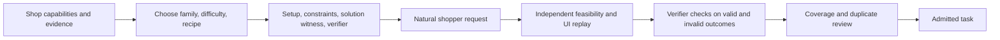

# Shopping Task Generation Proposal

Status: **Proposed**. Reviewed against `v2/5-cutover` at
[`230c185a`](https://github.com/agentic-foundation-modeling-research/shop-gym/commit/230c185a6fd7f1616bb18cdf276d451f03c976ab)
on 2026-10-22. Audience: ShopGym environment, task-generation, and evaluation owners.

## Overview

Build a diverse shopping benchmark by choosing the generation method and verifier
for each user goal. The proposed catalog contains **23 task families** spanning
discovery, shopping cart operations, purchase, accounts, repeat shopping, and
after-sales, plus **6 scenario variations** that can be applied across families.
Start with the capabilities available on the cutover branch and expand the
environment where realistic use cases require additional state or actions.

The agreed constraints for this proposal are:

- Use **shopping cart** throughout the task catalog.
- Use exactly three task difficulty tiers: **Easy, Medium, Hard**.
- Exclude visual product matching from the proposed task set for now.
- Keep one task catalog with category, examples, difficulty, current support,
  generation approach, required verifier, and verification difficulty/objectivity.

The catalog and rollout order below are proposals for review, rather than a
commitment to implement every family. This document specifies task coverage and
generation principles; implementation should be tracked separately.

## Terminology

- **Task family:** a shopper goal, such as revising a shopping cart or requesting
  a return. A family can contain tasks at several difficulty levels.
- **Category:** a grouping of families by shopping journey stage.
- **Scenario variation:** an additional requirement, such as clarification or
  recovery, applied to a base family. It is not a separate shopping journey.
- **Witness:** one validated solution demonstrating feasibility. Other solutions
  satisfying the same requirements must also pass.
- **Verifier:** a check of the answer, resulting state, or required interaction.
  A database query here means a query over catalog/fixture records or the episode
  snapshot; it does not assume an existing SQL service.

**Task difficulty** describes the work required of the agent:

- **Easy:** an explicit goal, direct evidence, few independent constraints, and
  one straightforward decision or state change.
- **Medium:** several constraints, evidence from multiple pages, comparison, or
  a short sequence of dependent decisions/state changes.
- **Hard:** interacting constraints or trade-offs, distributed requirements,
  cross-item compatibility, constrained optimization, or meaningful recovery.

Difficulty is not a click-count or prompt-length score. Adding many known SKUs
can be straightforward; selecting one compatible replacement can require hard
reasoning. Do not manufacture Hard variants for inherently simple operations.
Example labels **E / M / H** below mean Easy / Medium / Hard.

**Verification difficulty** is separate: **Low** for direct checks, **Moderate**
for joins, policy calculations, or constraint/optimization checks, and **High**
for semantic evidence assessment or interaction-sensitive evaluation. Objectivity
is **Exact** when a deterministic predicate defines success, **Mixed** when exact
checks are combined with semantic judgment, and **Rubric-based** when a material
part of success depends on subjective preferences. A costly optimizer can still
produce an objective verdict.

## Current Status

The support audit uses the **shared backend and storefront template on
`v2/5-cutover`**, rather than `main` or a planned specification. It is a static
code audit, not an end-to-end certification of every generated shop. A generated
shop may expose fewer features or extend its backend; task admission must check
that particular shop's data and UI.

The baseline already has:

- Ten deterministic seed skills: `exact`, `substitute`, `browse`, `filter`,
  `shipping`, `returns`, `e2e`, `account`, `checkout`, and `order_history`.
  These names are coarser than the proposed families. For example, `returns`
  locates a policy page; it does not execute a return. [C1]
- Episode-scoped shopping carts, customer registration and access-token
  login/logout, customer/address reads, order history, simulated checkout/order
  creation, inventory changes, reset, and grader snapshots. Basic login is
  therefore supported on this base. [C4] [C5] [C6] [C9]
- `string_match`, `url_match`, `locator_probe`, `state_check`, and explicit
  `llm_judge` checks. `state_check` supports equality, subsets, and array membership;
  all configured checks must pass. Fuzzy text matching also invokes a judge. [C2] [C3]
- An explorer that proposes tasks and checks page reachability/locators in a fresh
  browser. This is useful grounding, but it does not replay a full solution or
  establish semantic correctness and feasibility for every check type. [C11]

Important limits for the catalog:

- Current account seeds start **already signed in**. Registration, login, and
  logout need dedicated task generators and checks, rather than new basic auth
  infrastructure. Address/profile editing and saved-payment management do need
  additional mutations and UI. [C1] [C4] [C9]
- Checkout uses configured shipping/payment handles and simulated payment. Pricing
  supports a flat tax rate, flat shipping rates, and a free-shipping threshold.
  Discount codes are stored and reported applicable without eligibility or price
  effects; coupon optimization is not supported. Delivery dates, geographic
  serviceability, and pickup slots are not modeled in commerce settings. [C5] [C7] [C8] [C10]
- The shared state/schema does not provide wishlist, review, subscription,
  cancellation, return, exchange, or refund workflows. Seeded financial status is
  not a refund ledger. [C4] [C6] [C10]
- The task contract has one goal, optional login/shopping-cart setup, and evaluation
  checks. It has no typed difficulty, recipe, user-dialogue/reveal protocol, or
  cross-session memory contract. Built-in grading does not provide arbitrary
  constraint queries, an optimizer, state diffs, or event-order predicates. The
  judge receives the goal, rubric, final answer/URL, prior check results, and an
  optional final screenshot; full source evidence and interaction history need
  explicit plumbing. [C2] [C3] [C12]

## Desired Status

Each admitted task should have a realistic shopper intent, sufficient accessible
evidence, a valid setup, an executable solution or proven infeasibility, and a
verifier that accepts every valid outcome while rejecting plausible mistakes.
Coverage should span different goals, product domains, information sources,
state changes, and difficulty levels.

Keep environment readiness and generator coverage distinct. A task should not be
marked supported merely because its prompt can be generated, nor blocked merely
because its family lacks a dedicated seed generator.

## Proposal

### Unified task catalog

All examples are illustrative. Generation must substitute products, customer
records, policies, and supported actions from the target shop. Sizes, materials,
compatibility, reviews, and delivery promises must never be invented.

Support labels describe the family at the baseline: **Basic** = core environment
operations exist; **Partial** = a meaningful subset exists, with named gaps;
**Missing** = the core workflow requires additional environment support;
**Later** = expansion beyond the initial single-shop scope. A Basic label does
not imply that every proposed example or verifier is already implemented.

| ID | Category | Task family and realistic examples | Difficulty | Current ShopGym support and gaps | Proposed task generation approach | Required verifier(s) | Verification difficulty / objectivity |
| --- | --- | --- | --- | --- | --- | --- | --- |
| 01 | Discovery and decision | **Known-item discovery.** E: Find the TrailLite 20L backpack. M: Find its available navy variant, distinguishing it from the older model. | Easy–Medium | **Basic:** search, product pages, variants; `exact` seeds add any variant. Precise model/variant requirements need richer generation/checks. [C1] [C10] | Catalog-first: choose an available target; select identifying attributes; add similar-name distractors; phrase the request naturally. | Catalog query for matching product/variant IDs; final URL or structured answer; shopping-cart state if addition is requested. | **Low / Exact.** Accept all matching variants when the request permits alternatives. |
| 02 | Discovery and decision | **Constraint-based discovery.** E: Find a cotton shirt under $30. H: Find black, machine-washable trousers in my size under $80, excluding wool. | Easy–Hard | **Partial:** catalog/options, search/filter UI and a single-filter count seed exist. Multi-attribute predicates and normalized care/material data need work. [C1] [C10] | Answer-first constraint sampling: choose a feasible product/variant, derive constraints, query the full valid set, and add near misses. Include independently proven empty sets. | Catalog query plus numeric/availability predicates; validate the recommended item or shopping cart against every constraint. | **Low–Moderate / Exact** with structured attributes; **Mixed** when claims require prose interpretation. |
| 03 | Discovery and decision | **Occasion/use-case recommendation.** E: Suggest a housewarming gift under $25. H: Choose a gift for a beginner gardener with a small balcony and no storage space. | Easy–Hard | **Partial:** catalog browsing and text evidence exist. No dedicated needs-to-product generator or grounded preference rubric. [C1] [C10] | Needs-first scenario generation: select a credible use case/persona, retrieve supporting product facts, validate at least one fit, then author explicit preference criteria. | Exact budget/availability checks plus evidence-grounded LLM judge for suitability and explanation; human review for ambiguous rubrics. | **High / Rubric-based.** Several defensible recommendations may pass. |
| 04 | Discovery and decision | **Comparison and value.** E: Which of two coffee packs is cheaper per kilogram? H: Compare three backpacks on capacity, weight, price, and warranty using my stated priorities. | Easy–Hard | **Partial:** prices/descriptions available; units, warranty fields, comparison tasks and calculation checks are not standardized. [C10] | Catalog/policy-first comparison pairs; compute reference values/rankings before writing the request; vary trade-offs and ties. | Deterministic unit conversion, arithmetic, and ranking; source-backed factual checks; LLM judge only for qualitative trade-offs. | **Moderate / Exact** for numeric ranking; **Mixed** for weighted qualitative preferences. |
| 05 | Discovery and decision | **Substitution and unavailability.** E: Find a cheaper alternative to this mug. H: My preferred shoe is unavailable; preserve size, material, and fit within budget. | Easy–Hard | **Partial:** `substitute` seeds use a broad similarity judge; availability exists. Attribute-preserving substitutions and guaranteed alternatives need stronger grounding. [C1] [C10] | Sample a source item and explicit attributes to preserve/relax; enumerate alternatives; introduce stock constraints; optionally return no valid substitute. | Catalog/stock/price predicates and exclusion of the original; grounded semantic judge for functional similarity or fit. | **Moderate–High / Mixed.** Make preservation requirements objective wherever possible. |
| 06 | Discovery and decision | **Sizing, fit, and compatibility.** M: Use my measurements and the size chart to choose a shirt size. H: Find a replacement filter for my exact appliance model and reject a similar incompatible filter. | Medium–Hard | **Partial:** options/descriptions/metafields can carry evidence. Size charts and compatibility relations are not guaranteed or normalized. [C10] | Relation-first: curate or synthesize validated size/compatibility facts; choose a supported match and near-miss models; generate the request from those relations. | Table lookup/range checks or compatibility-graph query; check cited evidence and uncertainty when no supported match exists. | **Moderate / Exact** for explicit relations; **Mixed** for subjective fit. No unsupported fit guarantees. |
| 07 | Discovery and decision | **Review-grounded research.** M: Summarize recurring sizing complaints for these shoes. H: Compare recent verified-purchase reviews, distinguishing repeated defects from isolated complaints. | Medium–Hard | **Missing:** no standardized review dataset, review query/filter UI, or review-evidence verifier in the shared baseline. [C10] | Evidence-first: create/reuse a review corpus with dates, purchase flags, and annotated claims; sample corroborating and conflicting evidence; write research questions. | Review-record queries for date/purchase filters; source-span entailment and contradiction checks; LLM judge for synthesis and representativeness. | **High / Mixed.** Avoid grading a single preferred summary wording. |
| 08 | Discovery and decision | **Policy and store information.** E: What is the return window? H: For a discounted gift shipped internationally, explain the applicable shipping and return conditions. | Easy–Hard | **Partial:** policies/pages and policy-navigation seeds exist. Answer extraction and exception reasoning need new generators/verifiers. [C1] [C10] | Policy-first templates: extract rules, conditions, and exceptions with source spans; instantiate a scenario; precompute the applicable outcome. | Policy query/rule calculation when structured; evidence-grounded answer judge for prose; URL/locator checks only for explicit navigation goals. | **Low / Exact** for direct facts; **Moderate–High / Mixed** for interacting exceptions. |
| 09 | Shopping cart and purchase | **Variant and quantity selection.** E: Add two blue mugs. M: Add one medium black shirt and two large white shirts, using available variants only. | Easy–Medium | **Basic:** shopping-cart add/update/remove and variant options; `exact`/`e2e` seeds cover simpler cases. Exact variant–quantity assertions need strengthening. [C1] [C8] | Shopping-cart-state-first templates: sample available variants and quantities, record the intended line multiset, and express it as a shopper request. | Episode shopping-cart query keyed by variant ID and quantity; exact line multiset and no unwanted lines. | **Low / Exact.** Product titles alone cannot establish variant or quantity correctness. |
| 10 | Shopping cart and purchase | **Shopping cart revision.** E: Remove the duplicate mug. H: Replace the large pack with two small packs, preserve all other lines, and keep the total under $70. | Easy–Hard | **Basic:** mutations and prefilled-shopping-cart setup exist. Revision generators, baseline comparisons, and general constraint checks need adding. [C2] [C8] | Initial-state plus intended-delta templates; vary duplicates, substitutions, quantity changes, and coupled budgets; store untouched-line invariants. | Before/after shopping-cart diff, exact requested changes, catalog pricing, and unchanged-line checks. | **Low–Moderate / Exact.** Needs a diff verifier beyond static snapshot matching. |
| 11 | Shopping cart and purchase | **Multi-item shopping cart planning.** M: Choose a notebook and pen for under $20. H: Build a cooking kit for four campers, covering required roles with compatible items within budget. | Medium–Hard | **Partial:** multi-item shopping carts and simple composed `e2e` seeds exist. Role coverage, compatibility, feasibility search, and set-level grading are missing. [C1] [C8] | Witness-first: define a brief, construct and validate one feasible shopping cart, then derive a budget/request; store constraints separately from the witness. | Shopping-cart/database query; quantity, budget, role-coverage and compatibility predicates; semantic judge only for unstructured role suitability. | **Moderate–High / Exact or Mixed.** Any satisfying shopping cart passes; witness equality is invalid. |
| 12 | Shopping cart and purchase | **Promotions and total-cost optimization.** M: Apply an eligible 10% coupon. H: Choose the best legal coupon combination for my shopping cart, including shipping and a useful threshold top-up if it lowers the payable total. | Medium–Hard | **Partial:** flat tax/shipping and a free-shipping threshold work. Coupon eligibility, discounts, stacking, and promotion pricing are **missing** despite stored codes. [C7] [C8] | Pricing-rule-first scenarios with a feasible shopping cart; enumerate legal coupon sets; independently compute costs and an optimum for the declared candidate space. | Deterministic pricing engine plus exact coupon eligibility/stacking checks and optimizer; validate useful top-up requirements separately. | **Moderate–High / Exact** for structured rules. Declare whether optimality is for a fixed shopping cart or a bounded product-choice space. |
| 13 | Shopping cart and purchase | **Delivery, pickup, and deadlines.** E: Does the shop deliver to my country? H: Find the cheapest option arriving before Friday, with pickup as a fallback. | Easy–Hard | **Partial:** policy text and flat shipping choices exist. Geographic eligibility, delivery estimates, cutoff times, pickup locations/slots, and corresponding UI need support. [C5] [C10] | Policy templates for informational tasks; later sample destination, episode date, service rules and slots, ensuring a feasible option or proven impossibility. | Policy evidence for informational answers; serviceability query, calendar/cutoff calculation, and shipping/pickup state checks for executable tasks. | **Moderate / Exact** with structured logistics; **Mixed** for prose-only policy interpretation. |
| 14 | Shopping cart and purchase | **Checkout and order placement.** E: Complete guest checkout for this shopping cart using supplied details. M: Place the order to my office with the specified shipping/payment options and final amount. | Easy–Medium | **Basic:** guest/customer simulated checkout, orders, stock checks, and checkout UI exist. Current seed starts signed in with a prefilled shopping cart; guest/method/total checks need extension. [C1] [C5] [C9] | Scenario templates with valid initial shopping cart, identity, address, and commerce settings; calculate expected totals and expected order delta before generating prose. | New-order delta, customer/email, exact line multiset, address, shipping/payment handles, totals, inventory delta, and no duplicate order. | **Low–Moderate / Exact.** An existing seeded order must not satisfy completion. |
| 15 | Accounts and repeat shopping | **Account access.** E: Register with these details without marketing opt-in. M: Sign in, report the default-address city, then sign out. | Easy–Medium | **Basic:** register/login/logout routes and backend exist. Current `account` seed only reads an already-signed-in account. No password-recovery/OTP workflow. [C1] [C4] [C9] | Persona/scenario templates: choose a seeded identity or unused email, state supplied credentials, define expected customer/session changes; add explicit auth task seeds. | Customer creation/marketing flag query; session and browser-cookie/access checks; profile facts; ordered interaction checks for login-then-logout. | **Low / Exact** for terminal states; **Moderate / Exact** for required action order. Terminal logout alone does not prove login occurred. |
| 16 | Accounts and repeat shopping | **Profile, addresses, and payment preferences.** E: Save my office address. M: Make it the default for future purchases, remove an obsolete address, and preserve existing orders. | Easy–Medium | **Missing for edits:** profile/address reads exist, but profile update, address CRUD/default changes, and saved-payment management do not. [C4] [C9] | State-transition templates: seed multiple records, define the requested delta and untouched entities; keep address/profile and payment-preference variants capability-gated. | Before/after customer/address/payment queries, default-reference integrity, and unchanged existing orders. | **Low–Moderate / Exact.** Requires domain mutations/UI and diff checks. |
| 17 | Accounts and repeat shopping | **Wishlist and saved plans.** E: Save these two products for later. M: Move available saved items below $30 into my shopping cart while retaining unavailable items in the wishlist. | Easy–Medium | **Missing:** no shared wishlist state, mutations, persistence, or UI. [C6] [C10] | Initial saved-list plus target-state templates; compose with availability and price constraints after wishlist support exists. | Wishlist/shopping-cart set queries and before/after diff; quantity, retained-item and no-duplicate checks. | **Low–Moderate / Exact.** Multiple selected sets can be accepted when the request permits choice. |
| 18 | Accounts and repeat shopping | **Order lookup, status, and spending.** E: Report my latest order status. H: Calculate kitchen-category spending last quarter after partial refunds. | Easy–Hard | **Partial:** customer order history/detail and latest-order seeds exist. Spending joins/calculations need verifiers; partial-refund accounting needs a refund ledger. [C1] [C6] [C9] | Order-history-first queries: seed dated orders and line/category relationships; compute aggregates before wording; add refund records only when modeled. | Customer-scoped order query; deterministic date/category joins, arithmetic and refund accounting; exact factual answer checks. | **Low–Moderate / Exact.** Define gross/net, tax/shipping allocation, and the time window. |
| 19 | Accounts and repeat shopping | **Reordering.** E: Add the coffee from my last order to my shopping cart. H: Repeat the office order without pens, double the paper, and substitute an unavailable item. | Easy–Hard | **Partial:** history, shopping-cart operations, and checkout exist. No dedicated reorder generator; stock-aware reconstruction and substitution checks need adding. [C1] [C6] [C8] | History-to-shopping-cart composition: select a prior order, transform line constraints, validate current availability, then generate natural repeat-shopping intent. | Join source order to resulting shopping cart/new order; exact quantities/exclusions; availability and substitution predicates. | **Moderate / Exact** for fixed transformations; **Mixed** for semantic substitutes. A one-click reorder API is optional. |
| 20 | After-sales | **Order modification and cancellation.** E: Cancel my unshipped order. H: Cancel only the duplicate order and change the other order's address if policy permits. | Easy–Hard | **Missing:** order reads/creation exist; cancellation, editable-order rules, address changes, and inventory/payment effects are absent. [C5] [C6] | Policy-constrained state transitions: seed eligible/ineligible orders and duplicates, compute permitted actions and expected deltas, then write the scenario. | Order-state diff, eligibility rules, inventory/payment effects, and unchanged unrelated orders. | **Moderate / Exact** with structured lifecycle rules. Need process checks when attempted forbidden actions matter. |
| 21 | After-sales | **Returns, exchanges, and refunds.** E: Request a return for a damaged mug. H: Exchange a shirt's size, return one of two mugs, and explain why another line is ineligible. | Easy–Hard | **Missing:** policy lookup exists; no return/exchange/refund entities, mutations, line-level lifecycle, or UI. [C1] [C6] [C10] | Scenario templates over order lines, quantities, delivery dates, reasons, policy exceptions, and replacement stock; derive expected eligible actions and amounts. | Order-line/return/exchange/refund queries, policy/date/amount calculations, stock effects; evidence judge for the explanation. | **Moderate–High / Mixed.** State and amounts can be exact; prose eligibility explanations may require a judge. |
| 22 | After-sales | **Review submission and management.** E: Submit a four-star review using my supplied feedback. M: Update my own review after a replacement while preserving its purchase relationship. | Easy–Medium | **Missing:** review records, ownership/purchase links, submission/edit mutations, and UI are absent. [C6] [C10] | Authenticated state-transition templates with supplied user feedback, target rating, prior review and purchase relationship. Do not fabricate user experience. | Review/author/purchase queries, rating and update checks; semantic fidelity judge for supplied feedback and unintended claims. | **Low / Exact** for structured fields; **High / Mixed** for text fidelity. |
| 23 | After-sales | **Subscriptions and recurring replenishment.** M: Set coffee delivery to every four weeks. H: Skip the next shipment and reduce future quantity while keeping the subscription active. | Medium–Hard | **Later:** no subscription, schedule, skip/pause, recurring-order, or corresponding UI support. Treat as a later domain expansion. [C6] [C10] | Schedule/state-machine templates with episode time, recurrence rules, upcoming shipments, and intended future state. | Subscription/schedule query, calendar calculation, generated-shipment checks, and unchanged-history invariants. | **Moderate / Exact** with a controlled clock and explicit billing/shipping rules. |
| V1 | Scenario variation | **Personalization and memory.** M: Use the size from my last purchase. H: Recommend items respecting preferences supplied across earlier sessions. | Medium–Hard | **Partial:** customer/order facts can ground history-based tasks. Persistent preference memory and controlled cross-session evaluation are absent. [C2] [C6] [C12] | Persona/history-first: precommit preferences and their sources, seed accessible history, and specify which memory is available in which session. | History/preference queries plus recommendation predicates; evidence-grounded judge for soft preferences; memory-access records for cross-session claims. | **Moderate–High / Mixed.** Hidden requirements must be recoverable through permitted observations. |
| V2 | Scenario variation | **Clarification and confirmation.** M: Clarify which coffee I mean by “my usual.” H: Resolve an ambiguous delivery address and obtain the required confirmation before order placement. | Medium–Hard | **Missing interaction protocol:** browser episodes accept a single task goal; no built-in shopper dialogue, hidden requirements/reveal schedule, or confirmation-event checks. [C2] [C12] | Perturb a feasible task by withholding a required field; precommit the answer and reveal rule; use a scripted or constrained user simulator. | Required-question/confirmation event predicates, reveal-log validation, and final state checks against the resolved requirements. | **High / Exact** for scripted requirements and event order; **Mixed** if semantic question interpretation is needed. |
| V3 | Scenario variation | **Incremental requirement changes.** M: Switch my coffee request to decaf mid-task. H: Tighten the budget after a proposed shopping cart and preserve the remaining requirements. | Medium–Hard | **Missing orchestration:** shopping carts are mutable, but controlled user follow-ups and turn-specific requirement versions are not in the task runner. [C2] [C12] | Start from a validated task; precommit a timed or event-triggered change and a feasible revised solution; keep a versioned requirement ledger. | Interaction/reveal log, final constraints for the active requirement version, and checks that obsolete choices were removed. | **High / Exact** for structured changes; **Mixed** for open-ended revisions. Final state alone cannot validate reveal timing. |
| V4 | Scenario variation | **Infeasibility and recovery.** M: Report that no available product meets all constraints without purchasing. H: Recover from an insufficient-stock checkout error by selecting an allowed alternative. | Medium–Hard | **Partial:** checkout stock errors and atomic failure behavior exist. Proven-infeasible task generation, recovery predicates, and deterministic mid-episode stock injection need adding. [C5] [C2] | Perturb a feasible task and query to prove emptiness, or seed a quantity shortfall; define allowed relaxations and recovery outcomes in advance. | Empty-result/constraint proof, error or stock evidence, final shopping-cart/order checks, and no unwanted changes; grounded refusal/explanation judge. | **Moderate–High / Mixed.** A refusal by itself does not prove infeasibility. |
| V5 | Scenario variation | **Action boundaries and collateral effects.** E: Research options without changing my shopping cart. H: Update only the specified address while preserving every unrelated address and order. | Easy–Hard | **Partial:** isolated snapshots can show final state. General before/after invariants and transient-action/event verification are not built-in graders. [C3] [C6] | Attach explicit allowed-change sets and forbidden actions to any compatible task; seed unrelated records that must be preserved. | State diff for preserved entities; event/trajectory predicates for “never purchased/changed” or confirmation-before-action requirements. | **Low–Moderate / Exact** for terminal invariants; **High / Mixed** when only browser traces expose transient actions. |
| V6 | Scenario variation | **Cross-shop shopping.** M: Compare the delivered price of the same product at two shops. H: Split a compatible shopping cart across shops while including separate shipping charges. | Medium–Hard | **Later:** individual shops can be hosted, but the task/runner model selects one shop and one backend per episode. No coordinated multi-shop setup or grader. [C2] [C12] | Join validated catalogs across shops; precompute comparable identities, fees, and a feasible allocation; optimize only over a declared candidate space. | Cross-shop catalog/price queries and isolated state snapshots; identity/compatibility predicates and cost/allocation optimizer. | **Moderate–High / Exact** with explicit product equivalence; **Mixed** for semantic equivalents. |

### Choose generation methods by task structure

Use a small set of complementary recipes. The mapping in the catalog is our
proposal; the papers provide supporting methods rather than evidence that the
ShopGym implementation already has them.

1. **Scenario templates with setup, solution, and assertions.** Best for accounts,
   shopping-cart edits, checkout, and after-sales transitions. Parameterize customer
   records, initial state, permitted changes, and distractors before producing
   natural language. AppWorld's scenario construction and programmatic evaluation
   provide a useful precedent. [AppWorld](https://arxiv.org/html/2407.18901)
2. **Catalog/answer-first constraint generation.** Best for discovery, comparisons,
   and compatibility. ShoppingBench samples products, extracts fields, and writes
   grounded queries. EComAgentBench fixes the answer and typed rubrics before
   generating language, then distributes requirements across the query, profile,
   and clarification. For ShopGym, execute the predicates over the catalog and
   retain the complete valid set. [ShoppingBench](https://arxiv.org/html/2508.04266v1),
   [EComAgentBench](https://arxiv.org/html/2606.17698v1)
3. **Needs-first scenarios with evidence grounding.** Best for occasion-based
   shopping and functional substitutes. EcomScriptBench connects user objectives,
   script steps, purchase intentions, and products. Adapt that semantic bridge to
   shopper goals, then validate recommendations against actual catalog evidence
   and an explicit preference rubric.
   [EcomScriptBench](https://arxiv.org/html/2505.15196v1)
4. **Witness-first shopping-cart construction.** Best for multi-item planning and
   promotions. ComboShoppingBench validates a feasible witness before deriving
   coupons, budget, query, and rubrics. The witness proves feasibility; it is not
   the only correct answer. Its coupon optimality is evaluated for the submitted
   shopping cart, so global product-selection optimality requires a separate,
   explicit objective and search space.
   [ComboShoppingBench](https://arxiv.org/html/2608.09282v1)
5. **Functionality-grounded exploration.** Best for discovering tasks that a shop's
   actual pages and controls support. Amazon-Bench grounds queries in page content
   and interactive elements, followed by refinement and review. Extend ShopGuru's
   explorer with solution replay and independent assertions before benchmark
   admission. [Amazon-Bench](https://arxiv.org/html/2508.15832v1), [C11]
6. **Trajectory-first or reverse synthesis.** Useful for discovering affordances
   and collecting training demonstrations. NNetNav labels explored trajectories;
   SynWeaver uses website maps, reverse synthesis, refinement, and post-verification.
   For evaluation tasks, reconstruct the initial state and add an independent
   verifier before admission; a post-hoc description alone is insufficient.
   [NNetNav](https://arxiv.org/html/2410.02907v1),
   [SynWeaver](https://arxiv.org/html/2608.12429v1)
7. **State-machine search.** Best for controlled compositions of commerce state
   transitions after the domain model exists. AutoWebWorld uses finite-state
   machines and graph traversal to obtain reachable goals and trajectories.
   ShopGym could use the same principle to enumerate meaningful workflows while
   separately checking that the browser implements the modeled transitions.
   [AutoWebWorld](https://arxiv.org/html/2602.14296v1)
8. **Environment/task/verifier co-generation.** Useful when the desired family
   requires missing domain behavior. VeriEnv and WebArena Infinity are precedents
   for generating executable environments with verifiable tasks. Treat generated
   validators as candidates: review the domain contract and test them against
   correct alternatives and deliberately wrong outcomes to reduce shared errors.
   [VeriEnv](https://github.com/kyle8581/VeriEnv),
   [WebArena Infinity](https://github.com/web-arena-x/webarena-infinity)

For V1–V3, personalize or perturb a grounded base task rather than freely inventing
a conversation. Recent work on long-horizon shopping personalization motivates
testing consistency across interactions; it does not establish that our current
browser runner supports that protocol.
[Personalization Matters](https://arxiv.org/html/2610.11375v1)

### Generation and admission flow

Store category, family, scenario variations, task difficulty, generation recipe,
required capabilities, verifier difficulty/objectivity, and provenance with each
task. Keep private reference facts, valid-set predicates, witnesses, source spans,
and any hidden requirements outside the agent-visible goal. These are proposed
metadata/contract extensions; the current typed schema does not define them. [C2]

Apply the following admission rules:

1. **Capability and evidence gate:** required data/actions must exist in the target
   shop and be reachable through the agent's permitted UI. An LLM's unsupported
   inference cannot become a catalog fact.
2. **Independent feasibility check:** query or solve the constraints, then replay a
   solution in a fresh episode. For intentionally infeasible tasks, retain an
   explicit empty-set result or rule contradiction. A solver failure is not proof
   of infeasibility.
3. **Verifier validation:** check a correct solution, any legitimate alternative,
   and targeted errors such as wrong variant, extra item, stale seeded order,
   wrong total, or changed unrelated record. Record what each failed predicate
   means. Replay success alone does not establish verifier quality.
4. **Naturalness and disclosure review:** the request should express a plausible
   shopper need. Every necessary requirement must be stated or recoverable;
   freeze hidden requirements and reveal rules before an interactive run.
5. **Coverage and deduplication:** reject parameter swaps that add no meaningful
   intent, constraint, evidence, or workflow diversity. Split train/eval by scenario
   template and related catalog entities, rather than by paraphrase alone.

### Verification strategy

Prefer deterministic state/database queries for state changes and structured
facts. Validate variant–quantity pairs as sets/multisets, query newly created
orders relative to the initial snapshot, and calculate money in integer minor
units using the shop's declared rules. A title on the shopping-cart page is weak
evidence of correct contents; a coupon string is weak evidence of a discount.

Extend snapshot grading with constraint, aggregation, optimization, and
before/after predicates where needed. Preserve the existing lightweight checks
for goals they actually establish: URL checks for navigation, literal matching
for unambiguous reported facts, and locators for required UI evidence. Current
validation checks schemas/references and exact duplicate goals, rather than all
of these stronger properties. [C2] [C3] [C13]

Use an LLM judge for evidence-grounded suitability, synthesis, and faithful
explanations. Supply the relevant source records/spans and a decomposed rubric;
grade hard constraints separately. Audit a human-labeled sample and report judge
agreement and false-positive/false-negative cases before relying on subjective
scores. Publish exact and semantic components separately so one does not hide the
other.

For temporal requirements, record interaction/commerce events: login before
logout, confirmation before purchase, requirement reveal before action, and
forbidden transient changes. A final snapshot can establish preservation at the
end but cannot prove that an action never occurred. The runner already records
agent trajectories; a trusted event schema and corresponding grader predicates
remain proposed extensions. [C6] [C12]

### Diversity and difficulty coverage

Track coverage by **family × difficulty × scenario variation**, then inspect
product domain, budget range, constraint interactions, information source,
number of valid solutions, mutation type, and initial state. Include direct
requests, semantic needs, numeric decisions, state edits, repeat shopping, and
supported after-sales workflows. Include ties, multiple valid answers,
infeasibility, and recoverable errors where appropriate.

Assign difficulty from the required reasoning and interactions, then calibrate
with reference-agent runs and human review. Report per-family/per-tier results
and sample counts; keep environment failures separate from agent failures. Do not
force every family into all three tiers or let high-volume discovery templates
dominate the headline score. Dataset size, tier proportions, and final family
weights remain open decisions after a pilot.

## Alternative

**Expand only the existing deterministic seeds:** the smallest implementation
step and appropriate for exact discovery and straightforward state changes. It
would leave semantic recommendation, interaction, and missing commerce domains
underrepresented.

**Use a single LLM generator and judge for all families:** easy to prototype and
flexible, but weak at guaranteeing feasibility, exact state changes, independent
verification, and coverage. The proposed mixed approach retains LLMs for language
and semantic work while grounding structured requirements and outcomes in data.

## Execution Table

This is a proposed sequence of capability increments, not implementation work in
this PR. Each increment should emit only tasks supported by its target shop.

| Increment | Proposed scope | Environment / generation / verification work | Exit evidence |
| --- | --- | --- | --- |
| 1. Baseline-grounded pilot | 01–02, 08–10, 14–15, basic 18–19; supported subsets of 04–06 and V4–V5 | Add family/difficulty/recipe metadata; author generators over existing data and actions; strengthen exact variant, quantity, new-order and preservation checks. Add dedicated auth tasks. | Replayed feasible examples; proven negative cases; valid alternatives accepted; targeted wrong outcomes rejected; family/tier coverage report. |
| 2. Richer decision tasks | 03–06 and 11; more complex subsets of 02, 08, 18–19 | Validate attribute/size/compatibility/policy evidence; add witness search, arithmetic/constraint verifiers, and source-grounded semantic rubrics. | Independent witness checks and evidence audit; judge calibration on subjective components; no invented attributes. |
| 3. Interactive scenarios | V1–V5 on already-supported base families | Add hidden-spec/reveal protocol, shopper interaction, controlled requirement changes, memory/session fixtures, and event predicates. | Deterministic replay of scripted cases; reveal/confirmation ordering verified; simulator violations measured separately. |
| 4. Additional commerce domains | 07, full 12–13, 16–17, refund-aware 18, 20–22 | Add each domain's records, rules, mutations, storefront UI, fixtures, and snapshot/events before its generator. Reviews, promotions, logistics, account edits, saved lists, and after-sales can be delivered independently. | Domain contract checks plus fresh-episode browser replay and verifier validation for each admitted family. |
| 5. Later expansion | 23 and V6 | Subscription lifecycle/calendar and coordinated multi-shop episodes. Evaluate demand and cost before committing scope. | Reviewed domain semantics, isolation, replay, and cross-domain verifiers. |

Review decisions still needed: initial family/tier allocation, how much subjective
recommendation to include in the headline metric, and which missing domain to
prioritize after the baseline pilot. These choices do not prevent drafting or
reviewing the catalog.

## Appendix

### Code evidence

These links point to the implementation inherited from the audited baseline.
They support the Current Status and catalog support assessments; proposed
verifiers and generation recipes are not claims of shipped behavior.

- [C1: Seed generators][C1] — inspect the individual generators for exact coverage.
- [C2: Task and check schema][C2] — setup, goal, provenance, and evaluation contract.
- [C3: Grading dispatcher][C3] — current check behavior and judge inputs.
- [C4: Customer schema][C4] — auth mutations and read-only profile/address surface.
- [C5: Checkout resolver][C5] — validation, commerce settings, simulated placement.
- [C6: Episode snapshot][C6] — grader-visible customer, session, shopping-cart,
  order, and inventory state; [state transitions](../../../packages/shop_backend/src/state/shop_state.ts).
- [C7: Pricing][C7] — flat tax/shipping and free-shipping threshold calculations.
- [C8: Shopping-cart resolver][C8] — mutations and placeholder discount-code behavior.
- [C9: Account routes][C9] and [checkout route](../../../packages/shop-arena/templates/storefront/app/routes/checkout.tsx).
- [C10: Dataset schemas][C10] — catalog, customer, order, and commerce data contracts.
- [C11: Explorer proposal verification][C11] — page/locator checks, not full replay.
- [C12: Agent-under-test runner seam][C12] — single-goal browser episode;
  [episode execution](../../../packages/shop-guru/src/solve/solve.ts).
- [C13: Task validation][C13] — schema/reference validation, goal deduplication, caps.

[C1]: ../../../packages/shop-guru/src/seed/index.ts
[C2]: ../../../packages/core/src/schema/task.ts
[C3]: ../../../packages/shop-guru/src/grade/grade.ts
[C4]: ../../../packages/shop_backend/src/schema/customer.ts
[C5]: ../../../packages/shop_backend/src/resolvers/checkout.ts
[C6]: ../../../packages/shop_backend/src/sandbox/snapshot.ts
[C7]: ../../../packages/shop_backend/src/state/pricing.ts
[C8]: ../../../packages/shop_backend/src/resolvers/cart.ts
[C9]: ../../../packages/shop-arena/templates/storefront/app/routes/account
[C10]: ../../../packages/shop_backend/src/data/schema.ts
[C11]: ../../../packages/shop-guru/src/explore/verify.ts
[C12]: ../../../packages/shop-guru/src/solve/agent.ts
[C13]: ../../../packages/shop-guru/src/validate.ts

### Research scope and prior context

The method selection builds on the
[previous ShopGym research review](https://shop-gym.quick.shopify.io/public/specs/docs/shop-gym/shopgym_v2/shopgym_v2_task_research_review.html#methods)
and the primary papers/repositories linked above, including 2026 work through
October. The hosted review redirects to authentication in this environment; its
local counterpart was available as prior research context. It is not part of this
base branch. Current support claims were re-audited against code rather than
copied from that earlier review. This is a focused synthesis for the proposed
catalog, not an exhaustive literature survey or a replication of paper results.
